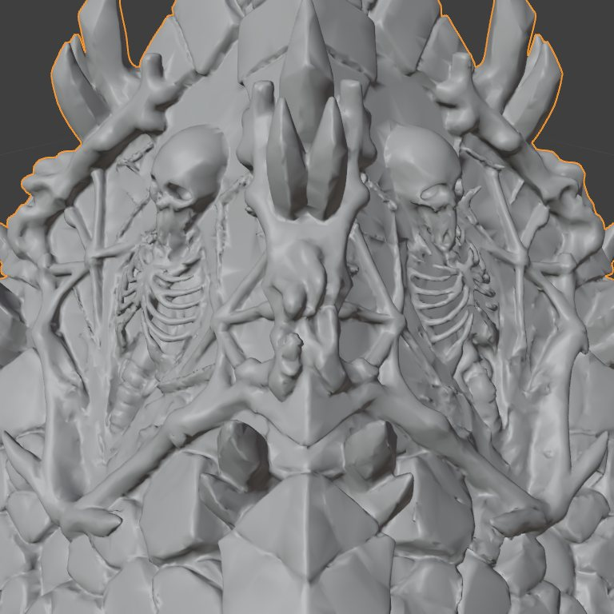
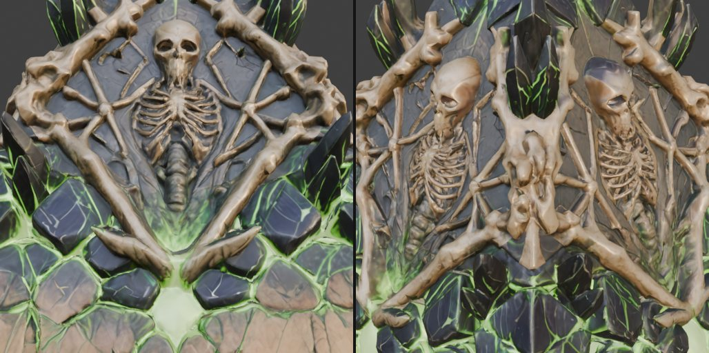
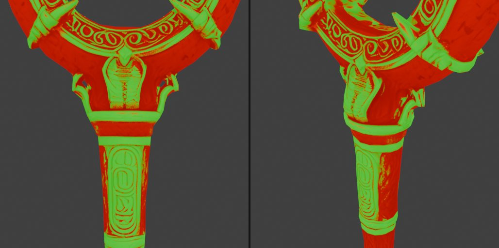
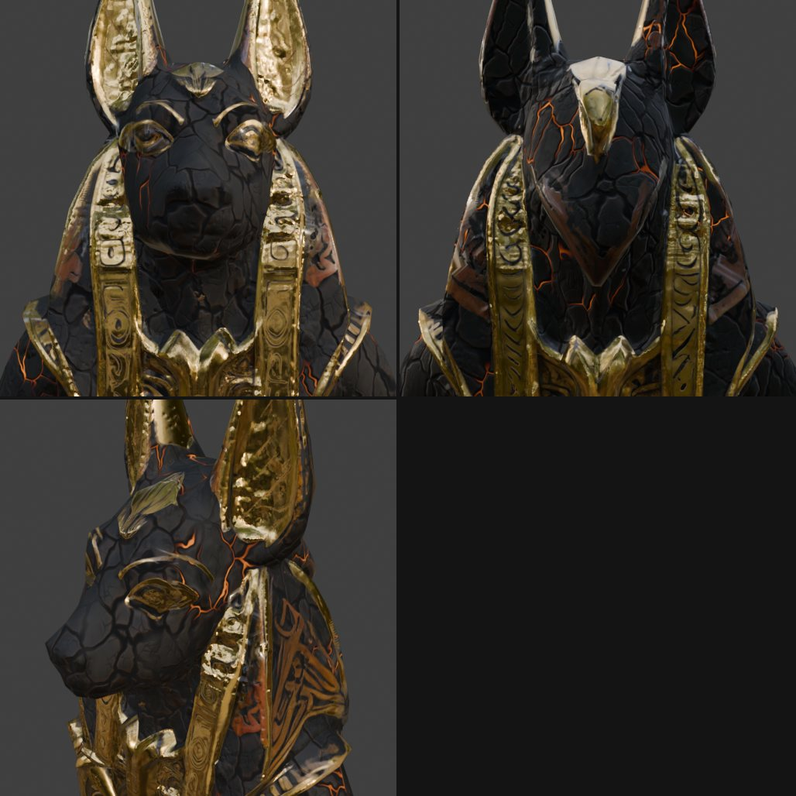
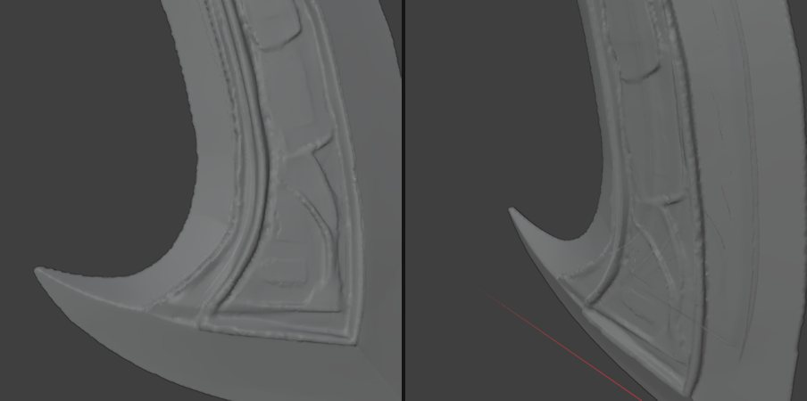
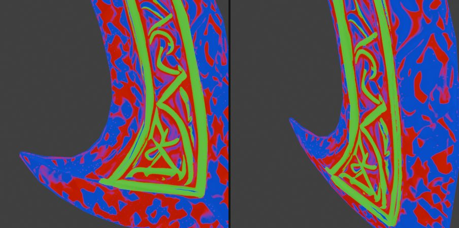
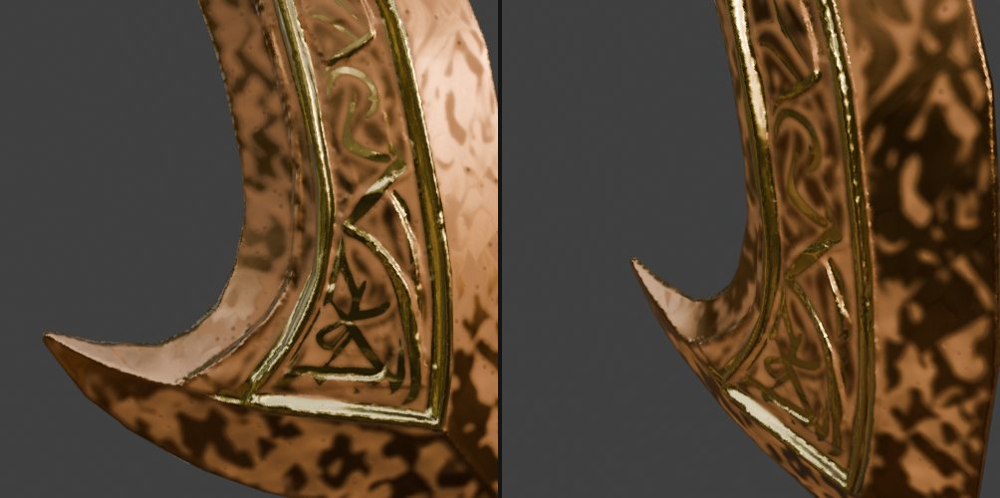
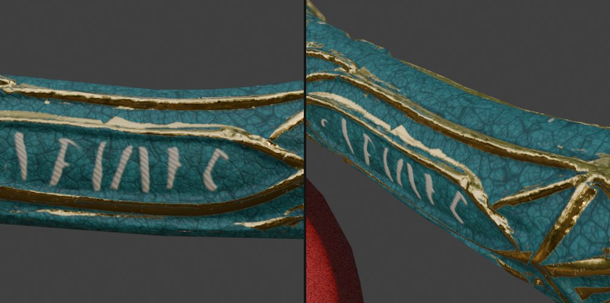
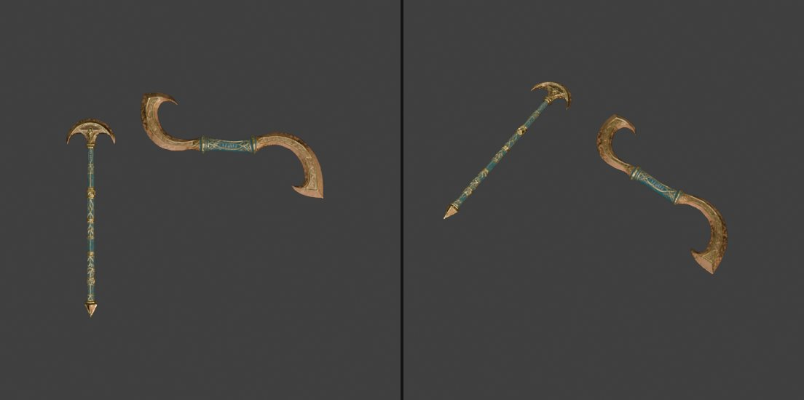

# 2026-11-04 (수) — 피라미드·무기 3종 최적화와 재질

[← History_Crash 개발 일지](../README.md)

| 시간 | 오브젝트 | 작업 | 결과 |
| --- | --- | --- | --- |
| 17:27 | 피라미드(`mesh_0` → `piramid_impe`) | 폴리곤 감축 | 1,008,726 → 50,000, 평균 오차 0.19mm |
| 17:31 | 피라미드 | 노멀맵 베이크(2048, OpenGL +Y) | 뭉개진 갈비뼈·뼈대 윤곽 복원 |
| 17:33 | 피라미드 | 연두색 영역 발광(0.6), 뼈 메탈릭 0.3, 러프니스 0.53 → 0.39 | 은은한 발광, 뼈 광택 |
| 17:43 | Anubis_Staff | 금, 진회색 → 탄 나무, 우드톤 → 오일 코팅, 틈 불씨(1.7%, 1.2) | |
| 18:43 | Copesh | 감축 + UV 재전개·재베이크 | 948,248 → 6,000 |
| 18:49 | Copesh | 청동 날, 금 장식, 옅은 녹, 가죽·실 문자 → 청록 가죽(19:10) | |
| 19:14 | parao_Staff | Copesh의 재질·표식 이식 | 같은 공방의 무기 |

## 렌더 체크

작업 중 Blender 뷰포트와 Unity 임시 카메라로 찍어 확인한 화면입니다.

*17:29 피라미드 감축 전후 클레이 비교. 갈비뼈와 가는 뼈대가 뭉개지는지 확인*

*17:37 노멀맵·발광·뼈 메탈릭을 적용한 최종본*

*17:45 Staff 재질 마스크(초록 = 금, 빨강 = 우드톤)*

*17:50 아누비스 머리의 탄 나무 균열과 틈 안 불씨*

*18:44 Copesh 6,000면 감축본 윤곽 비교(주황 = 원본 외곽선)*

*18:50 날의 청동·금·녹 영역 마스크*

*18:56 청동 날과 금 장식, 옅은 녹*

*19:12 손잡이 가죽을 청록으로 바꾼 뒤 실 문자 확인*

*19:20 parao_Staff와 Copesh를 나란히 놓고 '같은 대장장이' 느낌 비교*

