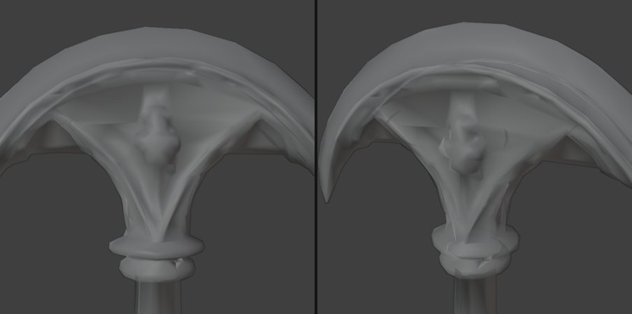
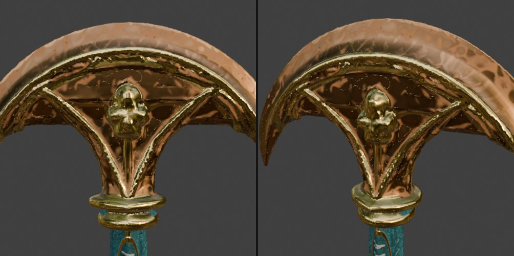

# 2026-11-05 (목) — parao_Staff 감축

[← History_Crash 개발 일지](../README.md)

| 시간 | 오브젝트 | 작업 | 결과 |
| --- | --- | --- | --- |
| 09:21 | parao_Staff | 감축 + 4K 재베이크 | 538,380 → 8,000, 평균 오차 0.17mm |

## 렌더 체크

작업 중 Blender 뷰포트와 Unity 임시 카메라로 찍어 확인한 화면입니다.

*09:22 면 수별 클레이 비교. 꽃 장식이 무너지는 지점을 보고 8,000면 선택*

*09:24 재베이크 후 최종*

