# 2026-11-06 (금) — 외벽·바닥 타일·기둥과 신전 배치

[← History_Crash 개발 일지](../README.md)

| 시간 | 오브젝트 | 작업 | 결과 |
| --- | --- | --- | --- |
| 08:52 | side_Plane_impe / _defalt | 감축 + 4K 재베이크 | 8,000 / 6,000 |
| 08:59 | side_Plane | 수정 그림자 제거, 저투과 보석(투과 0.3, IOR 1.72), impe 문양 발광 2.0 | 근접 시 옅은 자국 남음 |
| 16:33 | Tile_Crack_A~L_impe | 연두빛 균열 타일 12종, 32×24 배치 | 균열이 옆 타일로 이어짐 |
| 16:43 | 타일 | 격자선 축소(49 → 7mm), 밝기 평탄화 | |
| 16:48 | Tile_Crack_A~L_defalt | 같은 균열, 발광 없음 | 사암색, 러프니스 0.72 |
| 17:06 | Pillar_impe / _defalt | 보석 제거, 감축, 용접 | 약 7,000, 열린 엣지 0 |
| 17:43 | Zedtop_impe 6개 | 중앙 대칭, 간격 10칸(9.735m), 받침 2×2 타일 | 오차 0 |
| 17:44 | 피라미드·오벨리스크·벽 | 타일 중심선(Y −18.804) 정렬 | |
| 17:48 | defalt 세트 | impe 옆(Y로 36칸)에 같은 구조 | |
| 18:51 | anubis / horus | VARCO3D 시안 4장 | |

저장: `History_crash\Object\Enviorment_Obj.blend`(8.7MB, 오브젝트 1,607개)

## 렌더 체크

작업 중 Blender 뷰포트와 Unity 임시 카메라로 찍어 확인한 화면입니다.

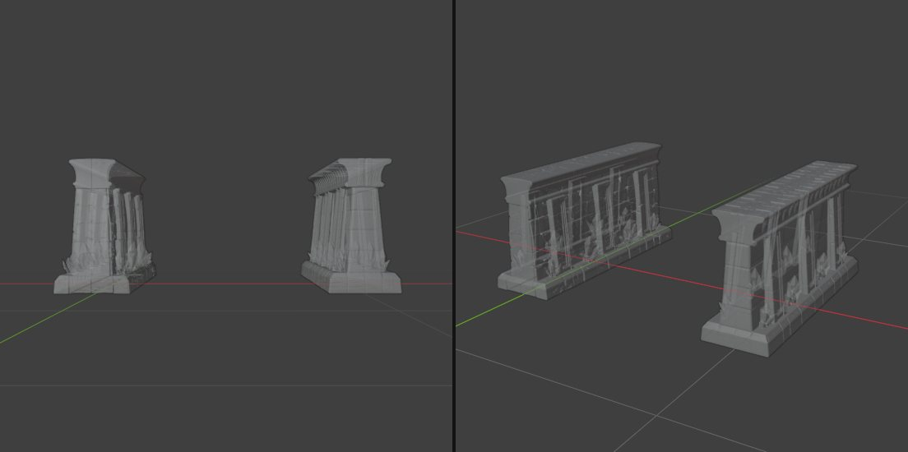

*08:53 side_Plane 감축본 클레이*

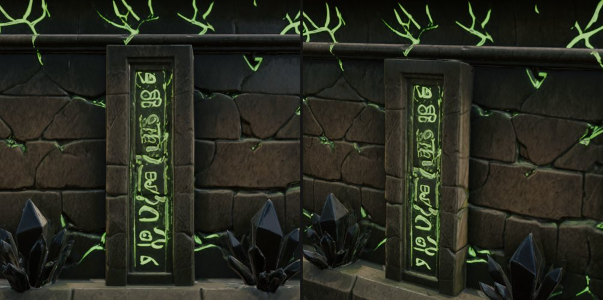

*08:56 impe 외벽 재베이크 결과*

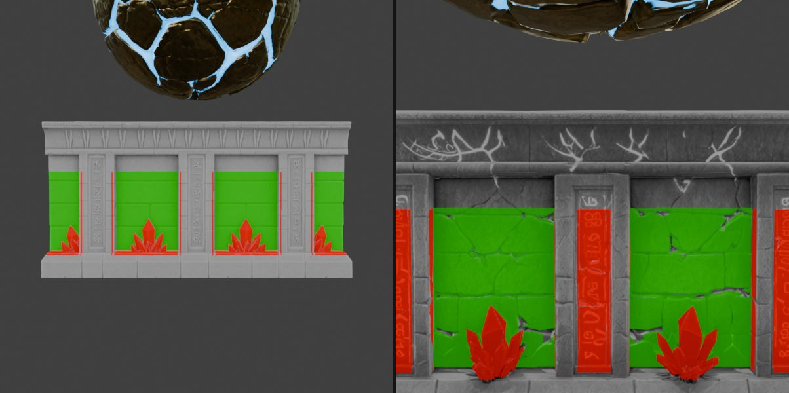

*09:02 베이크된 수정 그림자 영역(빨강)과 벽 영역(초록) 마스크*

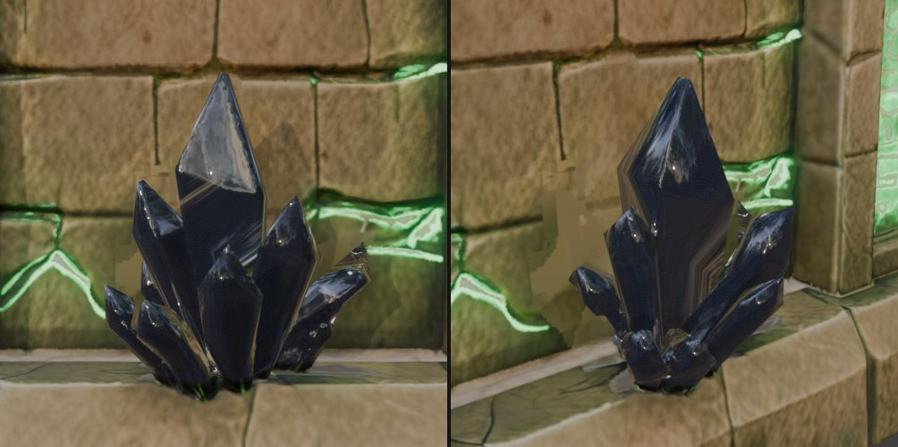

*09:32 그림자를 지우고 저투과 보석 재질을 입힌 수정*

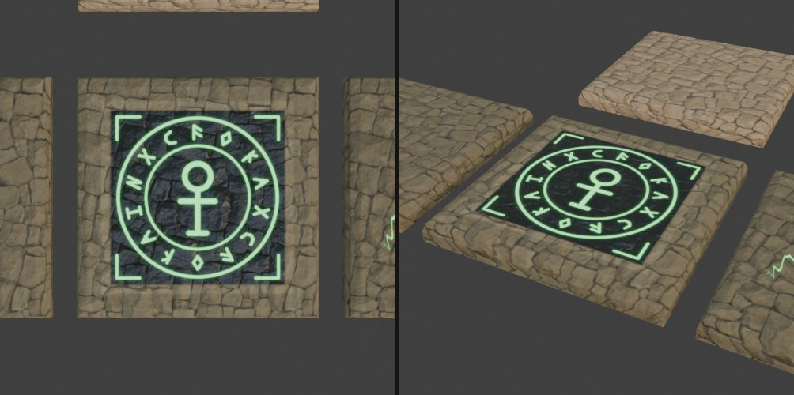

*16:31 첫 타일 시안(Vein/Rune/Shard). 방향을 바꿔 중단*

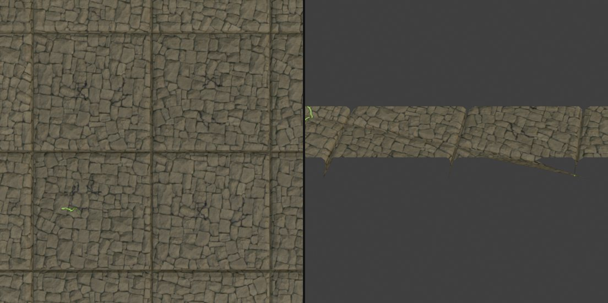

*16:42 균열 타일 32×24 배치. 격자선과 밝기 얼룩 확인*

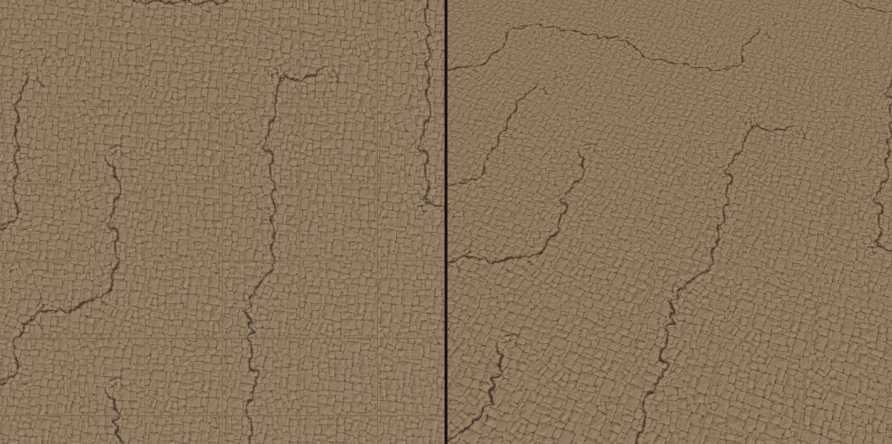

*16:51 발광을 뺀 '정화된' defalt 타일*

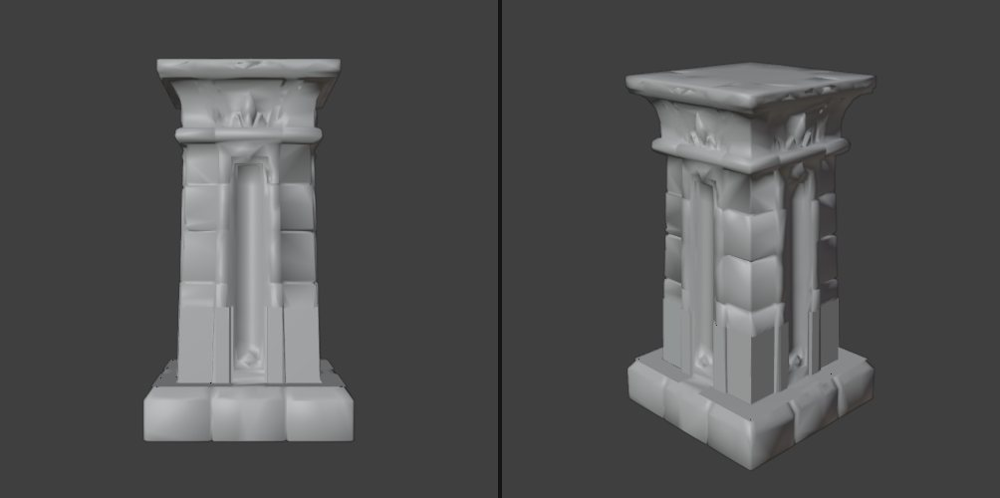

*17:16 보석을 없앤 Pillar 감축본 클레이*

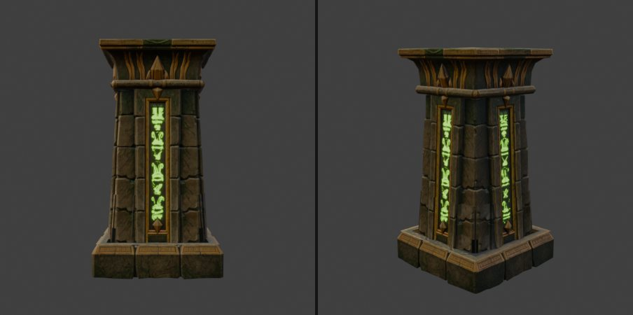

*17:23 용접과 재베이크를 마친 Pillar*

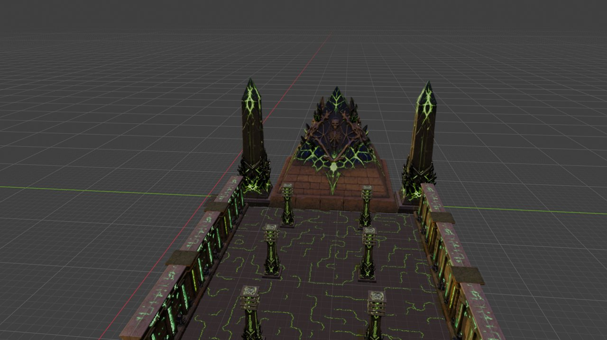

*17:43 제드기둥 대칭 배치 확인*

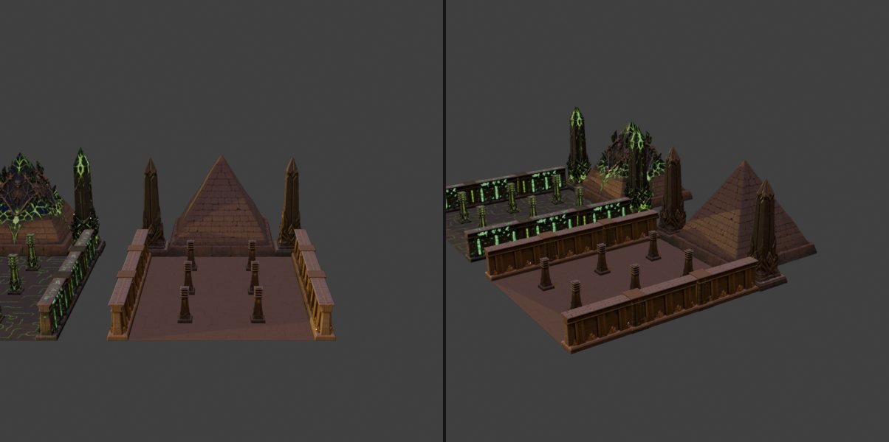

*17:50 impe 세트 옆에 같은 구조로 놓은 defalt 세트*

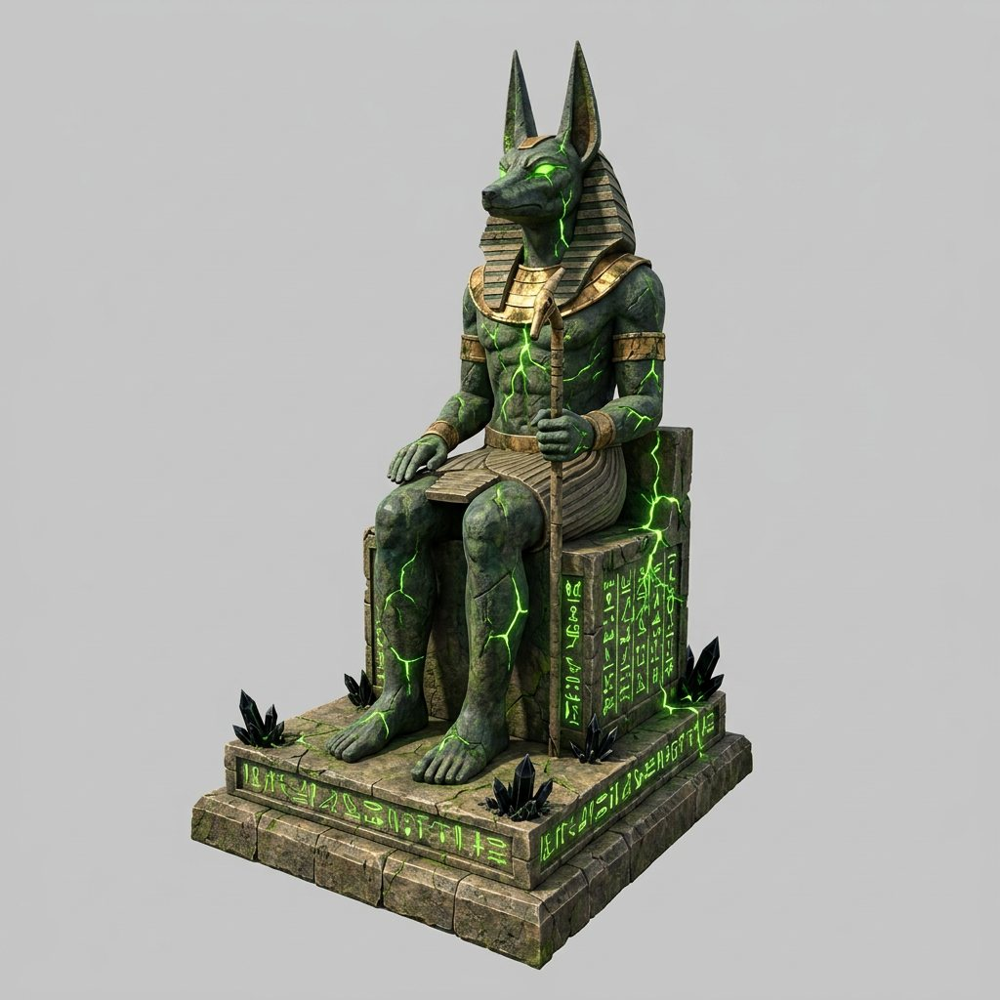

*18:50 VARCO3D 아누비스 시안(impe)*

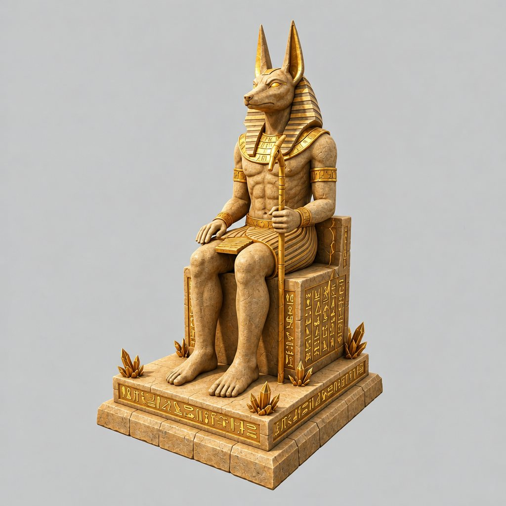

*18:50 VARCO3D 아누비스 시안(defalt)*

