# 2026-11-09 (월) — 석상·제단·입구, 파일 정리, 패턴 애니메이션

[← History_Crash 개발 일지](../README.md)

| 시간 | 대상 | 작업 | 결과 |
| --- | --- | --- | --- |
| 09:40 | anubis / horus _impe | 감축 + impe 재질 | 12,000 |
| 10:05 | anubis / horus _defalt | 감축 + defalt 재질, 대응 위치 배치 | 12,000 |
| 10:20 | 제단 | 3단 계단식 제단 + 정면 계단 규격, VARCO 시안 2장 | |
| 10:44 | Step_impe / _defalt | 감축 + 배치 | 12,000 |
| 10:50 | 바닥 | 세트당 타일 372장 추가(총 1,140), 38개 높이 맞춤 | |
| 11:51 | 파일 | 텍스처를 오브젝트 폴더로 정리, 이름에서 면 수 제거 | |
| 12:29 | 파일 | 텍스처 최적화 1.27GB → 296MB, `.blend` 104 → 10.9MB | |
| 15:43 | 파일 | 컬렉션 구조 기준 텍스처 폴더 재정리 | |
| 15:49 | Patten_Obj.blend | 패턴 5종 분리 | |
| 16:21 | 패턴 | 애니메이션 자연스럽게 재키잉 | |
| 16:46 | 패턴 | 파티클 라이트를 발광 메시로 교체, 점 제거, `Glow_Lights`만 유지 | |
| 16:52 | 패턴 | 방출용 저폴리 오브젝트로 이전 | 15 → 60fps |
| 16:59 | 패턴 | Unity 부하 계산 후 최적화 | 삼각형 135,168 → 75,168 |
| 17:10 | Copesh, Gem | 빛이 칼날을 감싸게, Gem 빛 줄임 | |
| 17:47 | Entrance / Mural | VARCO3D 시안 4장(200포인트) | |
| 18:00 | Entrance | 3D 가져와 감축·배치 | 16,000 |
| 18:12 | Mural | 벽화 제거, 외벽 모듈로 채움 | |
| 18:17 | Entrance | defalt 메시로 통일, 복셀 리메시 후 재감축 | |

저장: `Enviorment_Obj.blend`(11.7MB, 18:26)

## 렌더 체크

작업 중 Blender 뷰포트와 Unity 임시 카메라로 찍어 확인한 화면입니다.

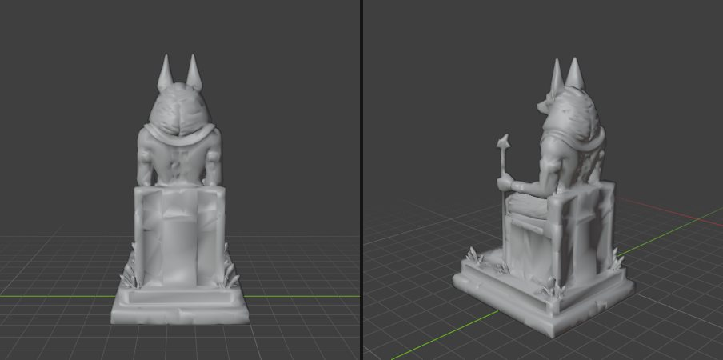

*09:41 석상 12,000면 감축본 클레이*

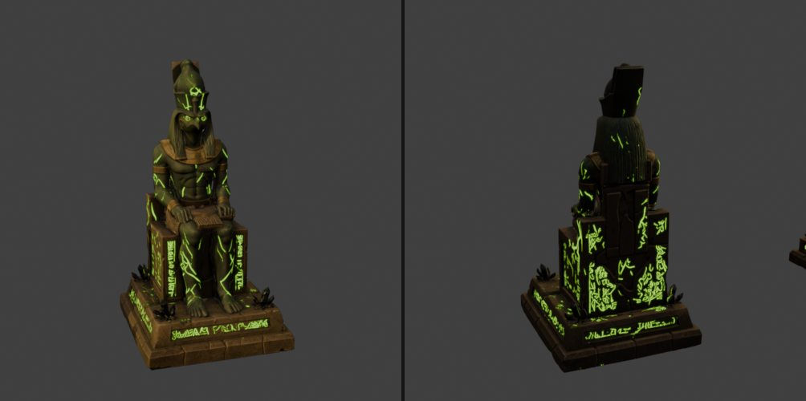

*09:46 impe 석상. 어두운 돌에 초록 균열·문양 발광*

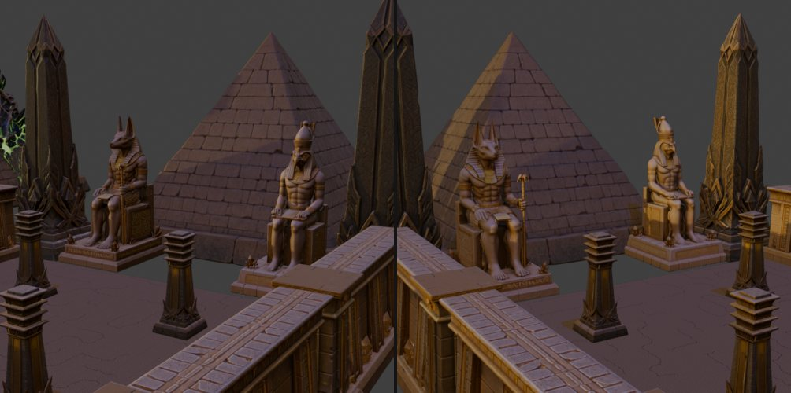

*10:08 defalt 석상을 피라미드·오벨리스크 사이에 배치*

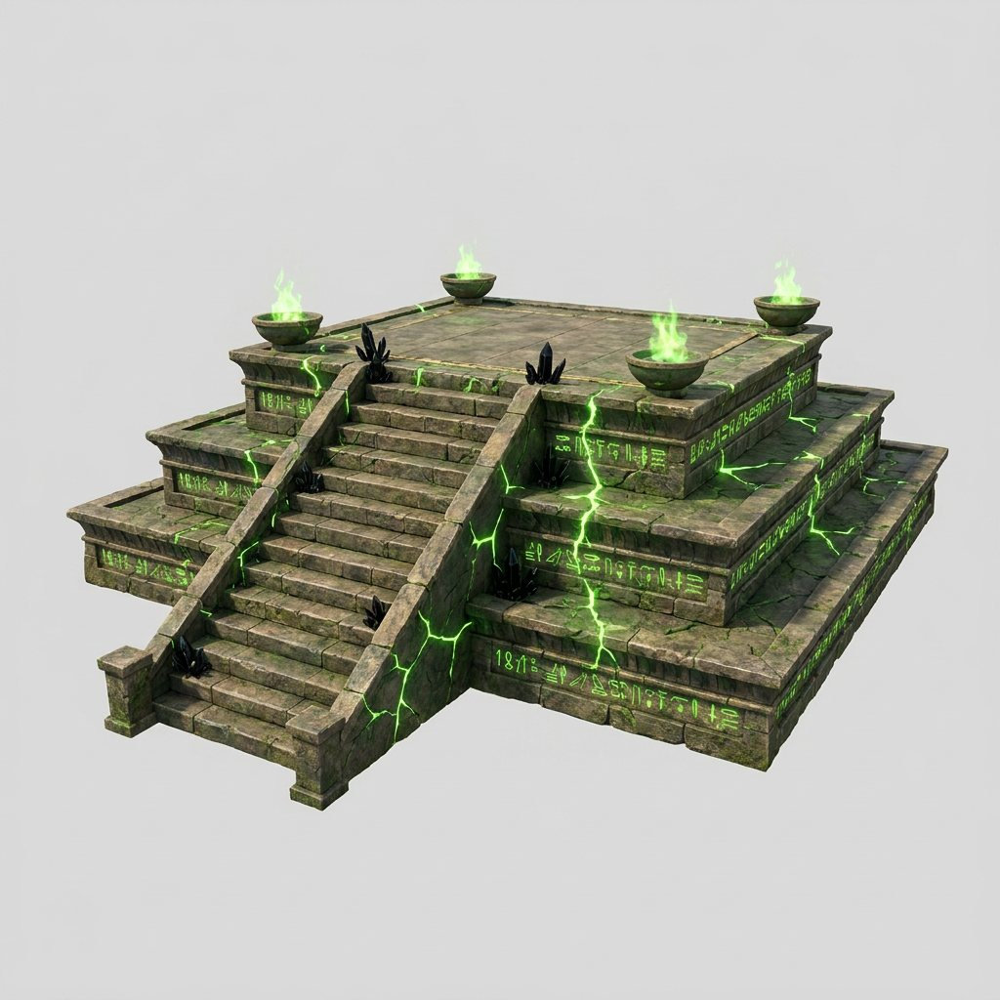

*10:32 제단 시안(impe, VARCO3D)*

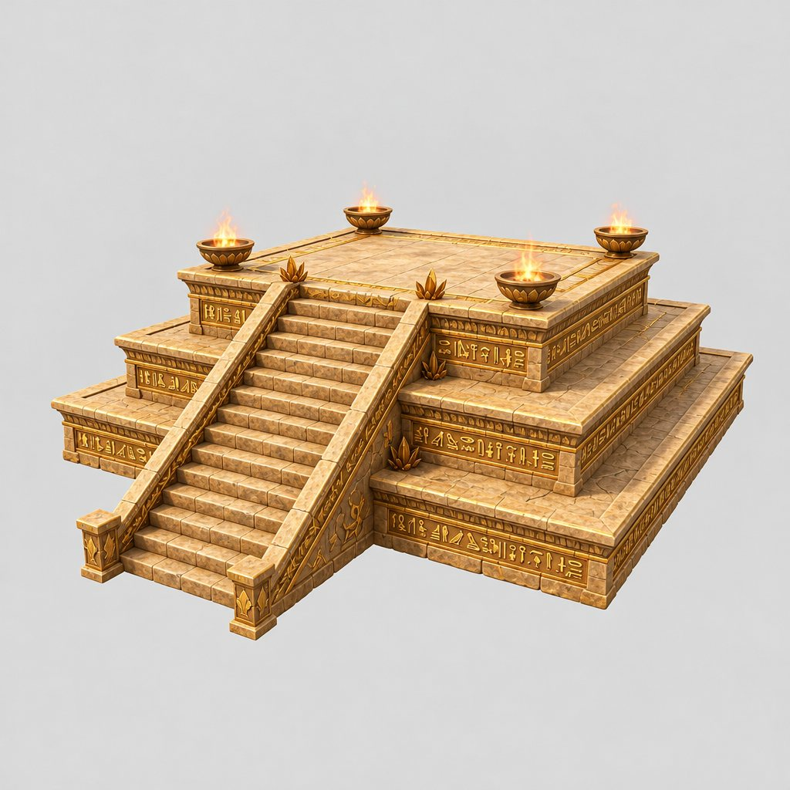

*10:32 제단 시안(defalt, VARCO3D)*

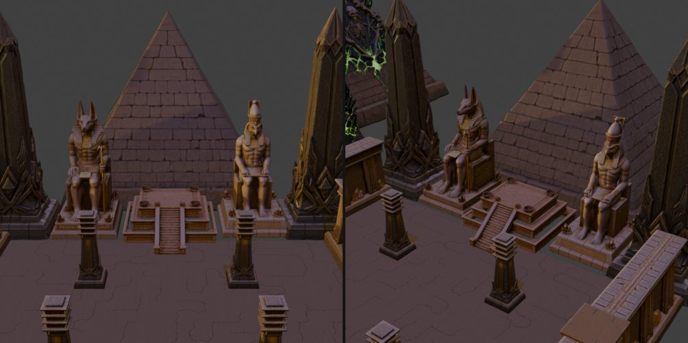

*10:48 Step 제단을 석상 사이에 배치*

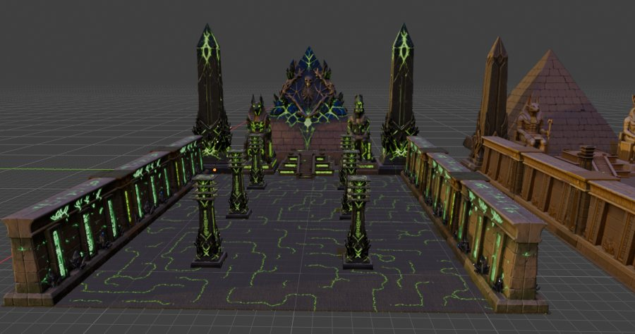

*11:54 바닥 확장과 높이 맞춤 후 impe 신전 전경*

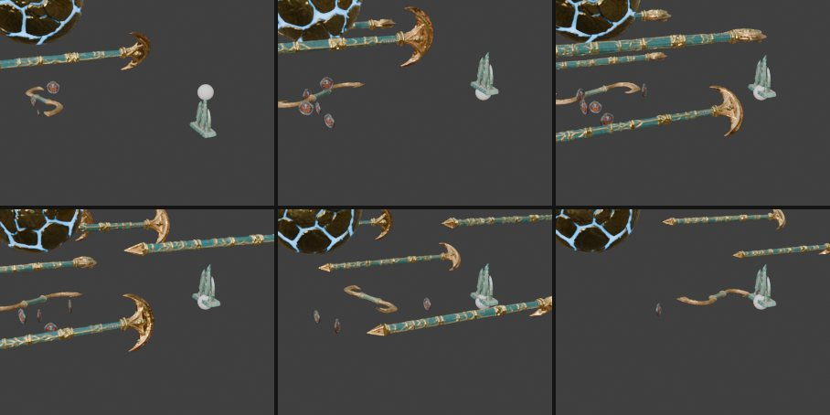

*16:24 패턴 애니메이션 프레임별 확인*

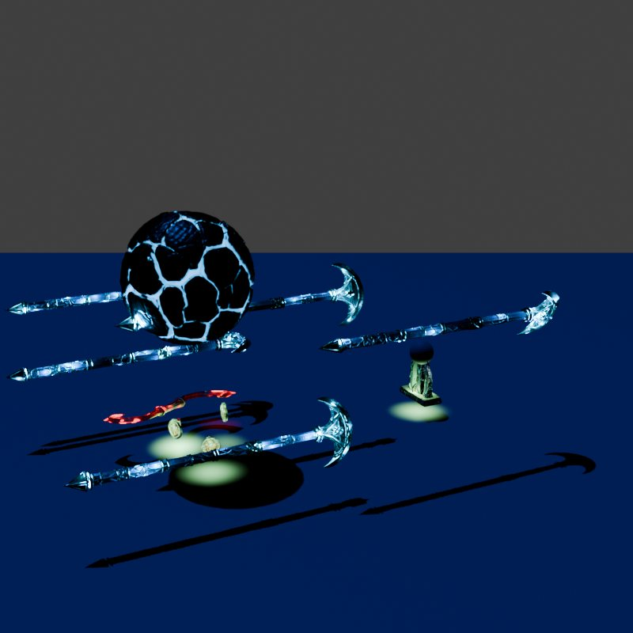

*16:51 파티클 라이트를 발광 메시로 바꾼 뒤 렌더*

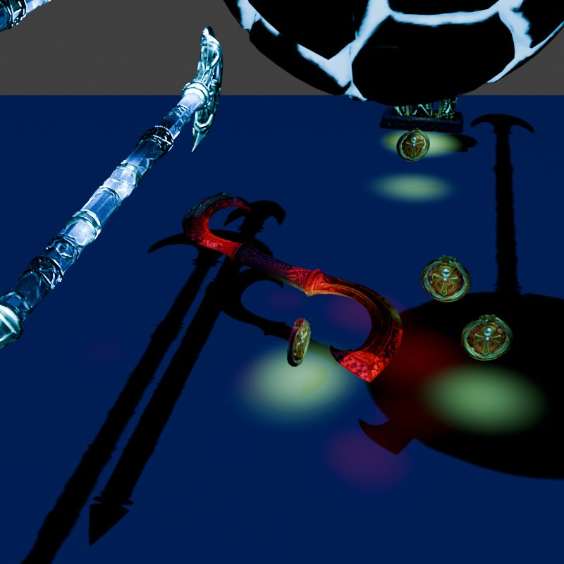

*17:11 점을 없애고 주변 광원만 남긴 상태*

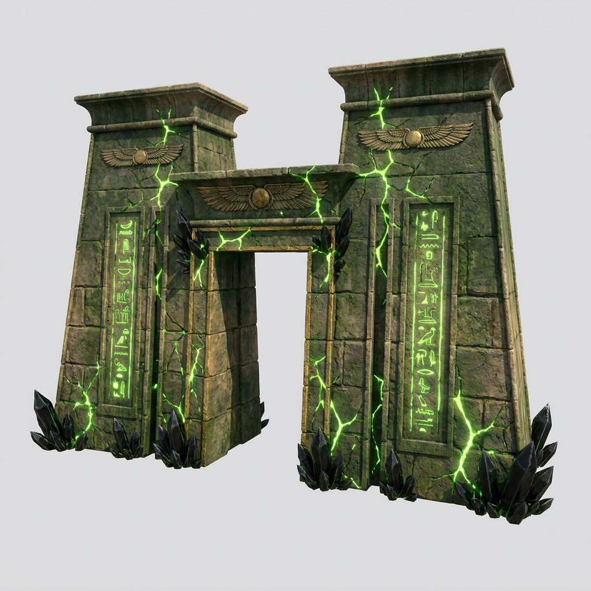

*17:54 정문(탑문) 시안(impe)*

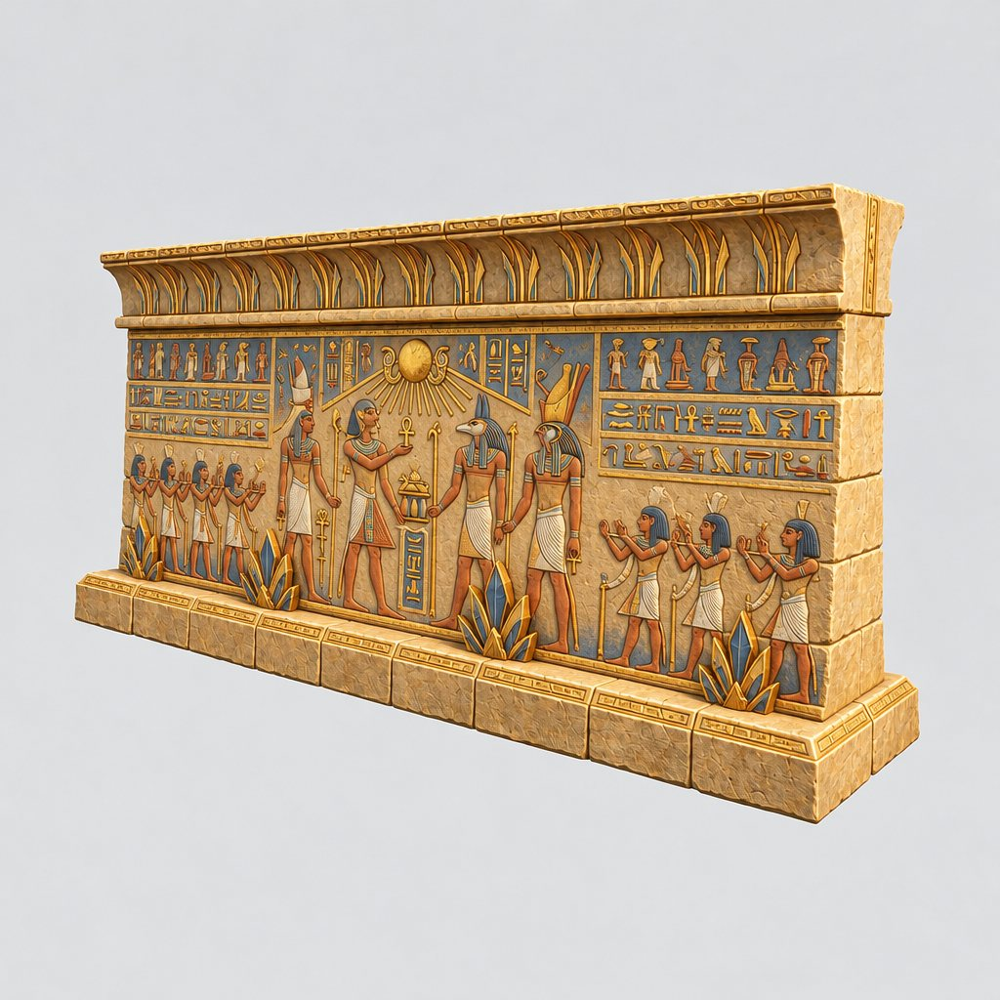

*17:54 벽화 벽 시안(defalt). 이후 벽화는 제거*

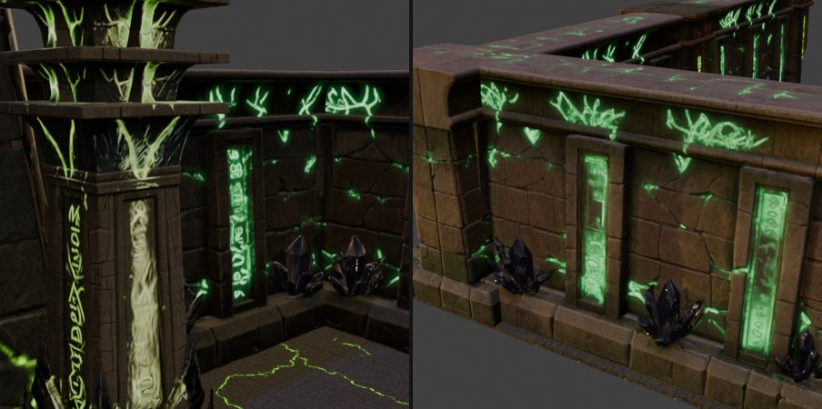

*18:13 벽화를 빼고 외벽 모듈로 채운 서쪽 벽*

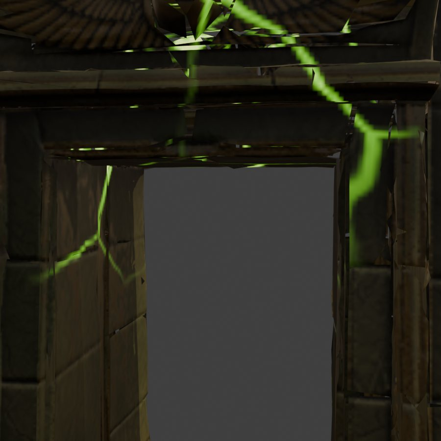

*18:21 입구 수정 전. 균열이 점선처럼 끊기고 잔삼각형이 보임*

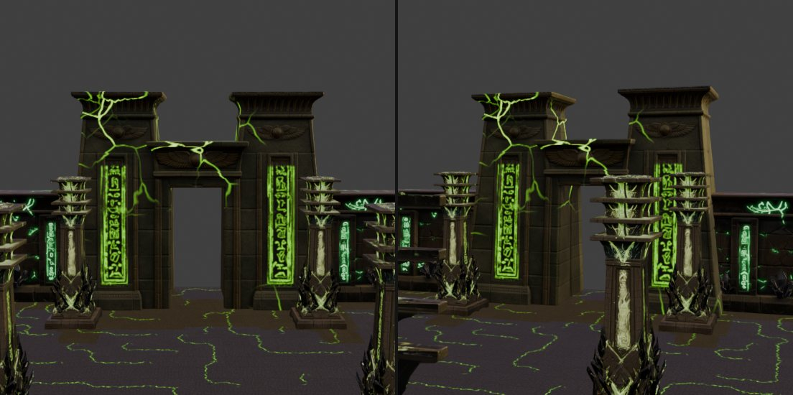

*18:25 입구 최종. 상형문자가 획 단위로 빛남*

