# 2026-11-10 (화) — 패턴 D 파괴, Unity 이관과 연출

[← History_Crash 개발 일지](../README.md)

| 시간 | 대상 | 작업 | 결과 |
| --- | --- | --- | --- |
| 08:53 | La_Sun_PattenD | 발광 균열을 따라 깨지는 애니메이션 | 파편 21개, 12fps·6.5초 |
| 08:58 | La_Sun_PattenD_Root | 부모 하나로 묶음 | |
| 08:59 | 패턴 A~E | glTF 내보내기 + `README_Unity.md` | |
| 09:17 | Unity Enviorment | Blender 배치 그대로 이관(스크립트 배치 없음) | 2,330개, 오차 0.01mm 이내 |
| 09:31 | 재질 | 투과 재질 반투명 문제 수정 | 42개 불투명 |
| 09:36 | Temple_impe / _defalt | 세트 + 파츠 프리팹 42개로 분할 | |
| 16:36 | 패턴 A~E + Player | 패턴별 프리팹, AimConstraint로 Player 조준 | |
| 16:43 | 씬 | 텍스처 압축 | 2.56GB → 0.74GB |
| 16:48 | 외곽 | 벽 구멍 메움 | |
| 16:58 | 렌더링 | GPU Resident Drawer, 오클루전(켜 둠) | 배치 1,814 → 약 152 |
| 17:13 | 패턴 라이트 | 패턴이 나타날 때만 켜짐(`LightSwitch` 레이어) | |
| 17:28 | Pattens | impe 신전 안 재배치, 타일 기준 스케일 0.48675 | |
| 17:30 | 패턴 라이트 | Rendering Layer로 자기 패턴에만 적용 | |
| 17:36 | Unity 폴더 | `#Art/Model/Enviorment`, `#Art/Model/Patten`, `#Art/Particle` | 참조 깨짐 0 |
| 17:45 | VFX_TorchLight_impe | 제단 화롯대 4개, impe 초록 | |
| 17:50 | 바닥 | 변형 12종, 세트당 1,140장(A 274·B 275) | |
| 18:00 | 패턴 B·D | 바위·먼지(B), 열기·파괴(D) 파티클, `VFXSwitch` 레이어 | |

저장: `Assets/Scenes/SampleScene.unity`(18:14)

## 렌더 체크

작업 중 Blender 뷰포트와 Unity 임시 카메라로 찍어 확인한 화면입니다.

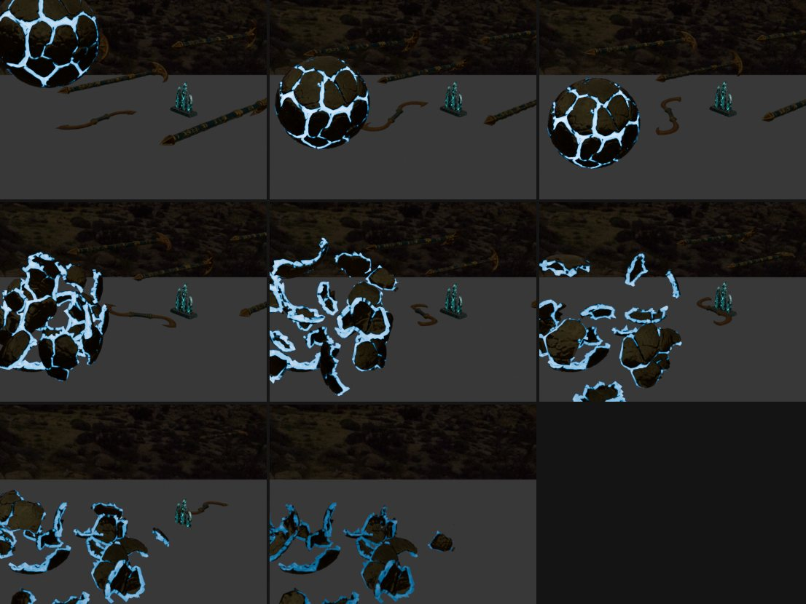

*08:56 패턴 D 낙하·파괴 프레임. 발광 균열을 따라 21조각*

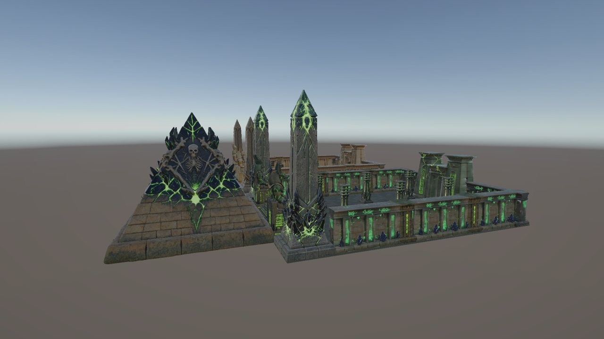

*09:30 Unity로 옮긴 직후 신전 배치*

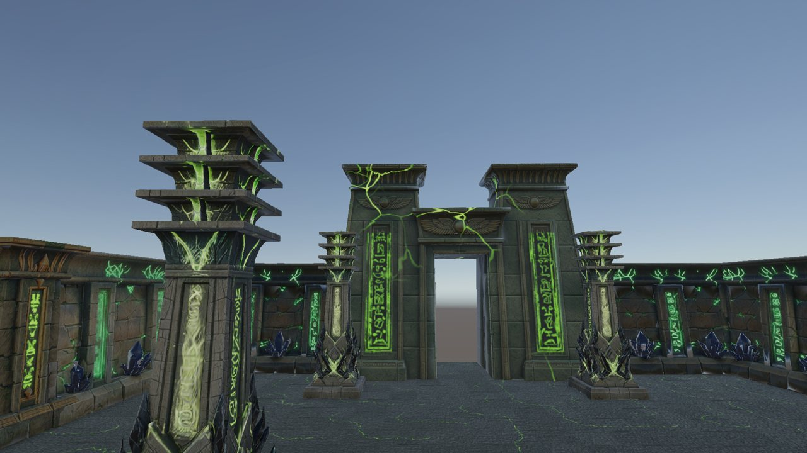

*09:38 투과 재질 문제를 고친 뒤 입구와 외벽*

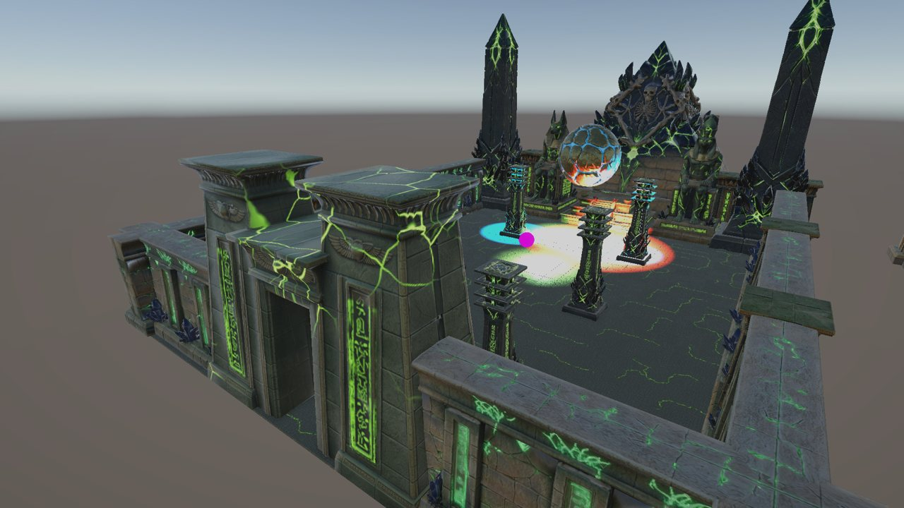

*17:29 패턴을 impe 신전 안으로 옮기고 타일 기준 크기로 맞춤*

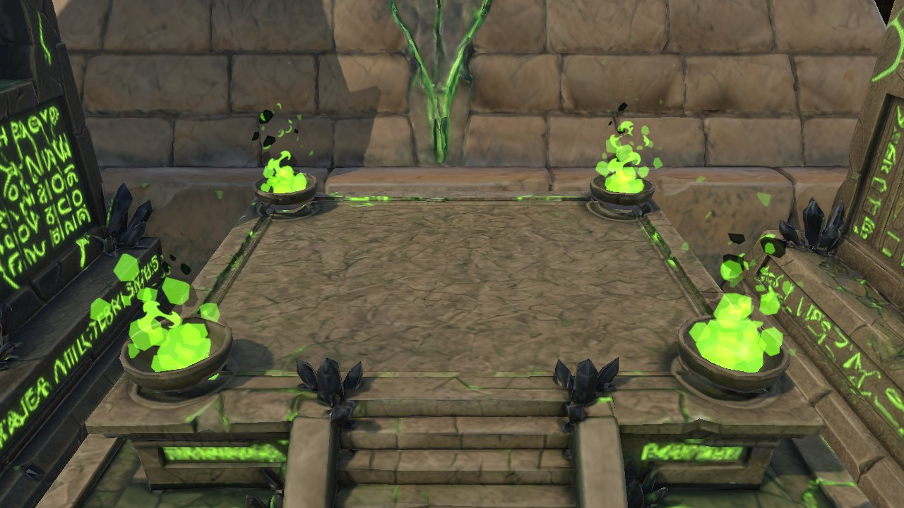

*17:48 제단 네 모서리 화롯대의 초록 횃불*

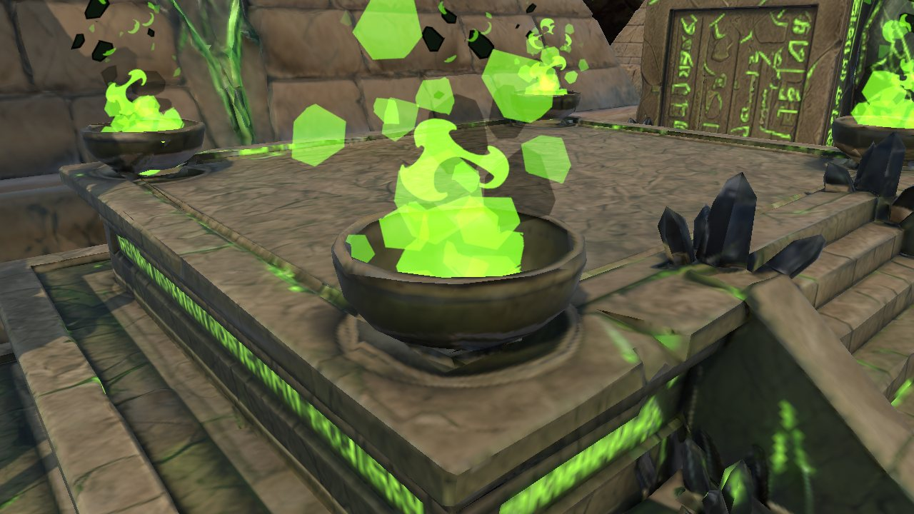

*17:48 횃불 근접. 주변 발광과 같은 초록*

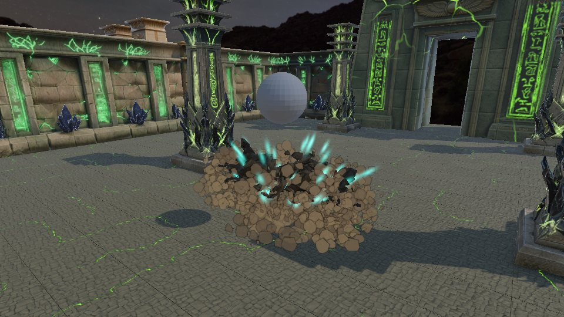

*18:07 패턴 B 첫 테스트. 먼지가 덩어리처럼 보여 소프트 텍스처로 교체*

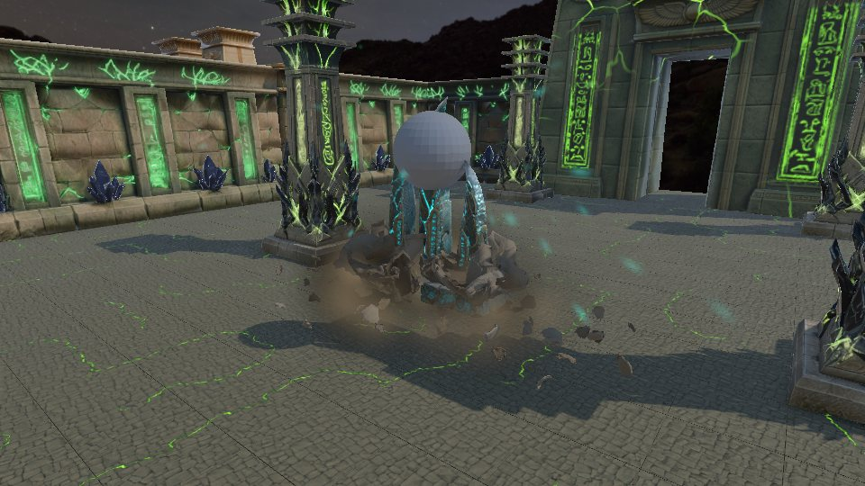

*18:08 패턴 B 최종. 바위 조각·먼지·청록 불똥*

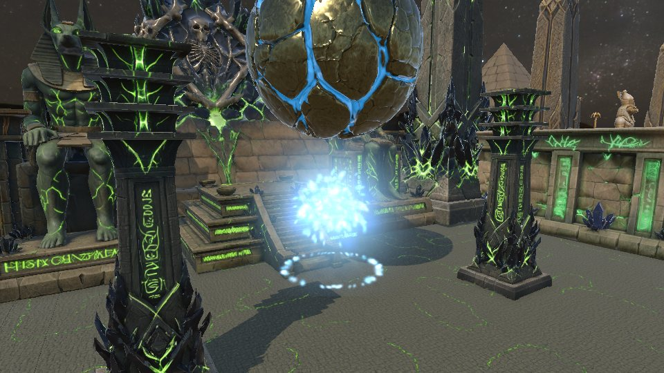

*18:07 패턴 D 첫 테스트. 열 폭발이 희게 날아가 밝기를 낮춤*

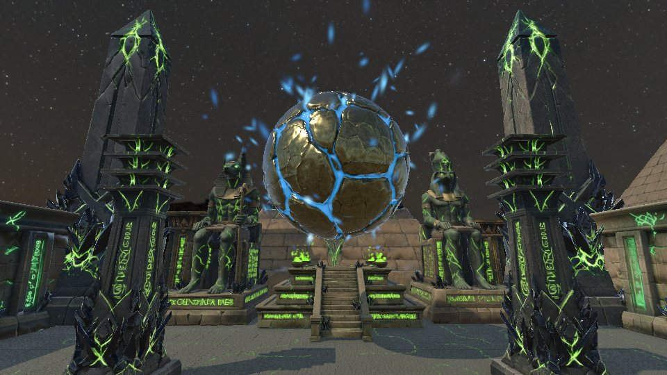

*18:10 낙하 전 구체에서 파란 불씨가 피어오름*

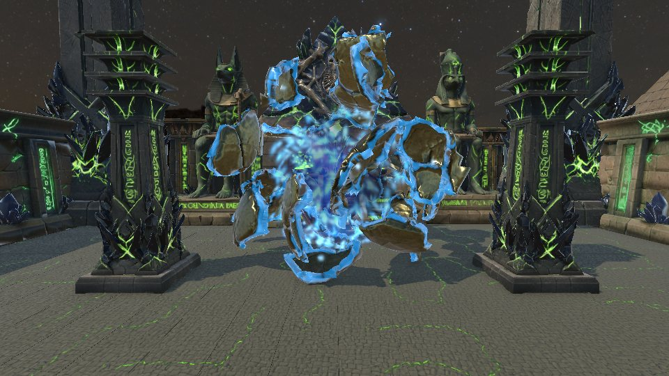

*18:10 파괴 순간. 파편 사이로 열기가 뿜어져 나옴*

