# 2026-11-12 (목) — 호루스 타일 붕괴, 체력과 낙하, Player 로브

[← History_Crash 개발 일지](../README.md)

| 시간 | 작업 | 결과 |
| --- | --- | --- |
| 08:50 | 호루스 타일 붕괴 기믹(MCP_TEST, 스크립트) | `HorusTileCollapse`: 15초 주기로 호루스 석상 눈이 빛나고(2초 경고, 해당 타일 균열이 점점 빠르게 깜빡임), 바닥 타일 12종(Tile_Crack_A~L) 중 한 종류가 깨져 7.5초간 사라졌다가 아래에서 올라오며 수복. 눈은 머리 메시 단면으로 위치를 잡은 발광 구체 2개와 점광원 |
| 08:50 | Player 체력과 낙하 데미지 | `PlayerHealth`(HP 5, 피격 후 무적 1초), 깨진 칸은 `TileGrid`의 구멍으로 처리. 점프로는 건널 수 있고, 구멍 위에 서 있거나 착지하면 떨어져 1 데미지 후 가장 가까운 안전한 칸으로 복귀. 패턴 B·D의 무작위 타일은 구멍을 피함. Play에서 다른 종류 붕괴 시 HP 유지, 발밑 종류(D) 붕괴 시 낙하와 HP 5→4, 옆 칸 복귀 확인 |
| 09:10 | 타일 붕괴 버그 수정과 연출 보강 | **원인**: 격자(TileGrid)가 만들어지기 전에 붕괴 스크립트가 칸 좌표를 계산해, 구멍이 실제로 꺼진 타일과 약 (−2, +5)칸 어긋남. 그래서 어떤 곳은 깨져도 괜찮고, 어떤 곳은 멀쩡해 보이는데 계속 빠짐. 실행 순서를 고정해 꺼진 타일과 구멍이 일치(14/14). 복귀는 주변 8칸도 멀쩡한 안전한 칸 중심으로, 복귀 직후 1초 무적·낙하 면제. 경고는 타일 전체가 은은한 호박색으로 깜빡이도록 바꿈. 구멍은 아래 맵 대신 깊이 4m의 어두운 구덩이와 바닥의 초록빛, 올라오는 불씨로 표현. 깨질 때 패턴 B 사암 재질로 덩어리·자갈이 튀어 구멍으로 떨어지고 흙먼지가 퍼짐 |
| 09:30 | 패턴 A·C 사출 속도 상승(난이도) | 발사 순간부터 스크립트가 투사체를 그 순간의 Player 위치로 직선 비행(회전·크기는 클립 유지). A 약 7 → 20m/s(도달 2.2초 → 0.84초, 지나간 뒤 수평으로 6m 더 날아감), C 약 17 → 28m/s(보석마다 도달 약 1초 → 0.6초, 착탄 시 잠깐 부풀었다 사라짐) |
| 09:40 | E 간격 확대, B 타격감, 메시 피격 | E 창 줄 간격을 2칸 → 3칸(±3·±6줄)으로 넓혀 넓은 범위 공격. B 함정은 0.08초 만에 튀어나와 0.2초 머문 뒤 바로 들어가는 한 번의 타격으로 바꿈(반복 찌르기 제거). 피격은 투사체 메시 13개에 MeshCollider를 달아 Player 구와 겹치면 스치기만 해도 HP 1 감소(1초 무적). 점프로 메시를 넘으면 피할 수 있음 |
| 10:00 | 희뿌연 흰 질감 제거 | 벽·입구·피라미드에 생긴 희뿌연 흰 막의 원인을 타일 붕괴 흙먼지로 판단. 조명을 받지 않는 셰이더라 밝은 황토색이 밤 장면에서 흰 막처럼 보였고, 붕괴마다 약 190개가 경기장 전체에 퍼짐. 밤 톤으로 어둡고 옅게, 타일당 1개, 작게, 짧게, 바닥 가까이로 바꾸고 화면 최대 크기를 제한. 붕괴 직후 Game 뷰에서 흰 막 없음 확인 |
| 09:40 | 흰 질감의 진짜 원인 해결(씬 조명) | 흙먼지를 고친 뒤에도 Play 중 항상 보였음. 편집 모드에서도 같아서 씬 설정을 비교하니, 원본과 달리 주변광 0·방향광 0이라 돌이 확산광 없이 하늘 반사만 받아 회청색으로 번들거림. 사용자 선택에 따라 중간 밝기로 맞춤(주변광 0.45, 방향광 0.25 푸른 달빛, 그림자 보정색 원본). 재질 본래 색이 보이면서 밤 분위기 유지 |
| 10:00 | 그림자 속 흰 질감 원인 분리와 해결 | 그림자가 드리운 곳에서 심하다는 관찰을 바탕으로 요소를 하나씩 끄며 측정. SSAO·그림자 맵은 무관하고, 반사 프로브가 없어 밤하늘을 세기 1로 반사하는 것이 원인(그림자는 직사광만 지우고 반사는 남아 그림자 속에서 비중이 커짐). 환경 반사 세기 1 → 0.4, 카메라 SMAA High 적용. 그림자 속 바닥 노이즈 4.95 → 2.87(−42%), 회청색 번들거림 사라짐 |
| 10:36 | Play 분석 | 가만히 선 Player 기준 한 주기(약 38초) 기록: 오류 0, 에디터 평균 8.2ms(122fps). A·C·E 명중으로 약 20초 만에 HP 0, B·D는 무작위 칸이라 빗나감. C 보석은 피격 후 무적 1초가 발사 간격 0.55초보다 길어 5발 중 3발만 데미지 |
| 10:36 | 패턴 C 데미지 규칙 | C 보석만 피격 후 무적을 무시하고 맞을 때마다 HP 1 감소(다른 패턴은 무적 1초 유지, `cIgnoreInvulnerability`). Play에서 보석 1~4번이 차례로 HP 4→0, 기존에는 막히던 2·4번째도 데미지 확인 |
| 11:10 | 패턴 B·D 예고와 압박 | **B**: 솟을 칸을 청록 사각 표시로 0.9초 먼저 보여 준 뒤 시전(점점 빠르게 깜빡이다가 함정이 뚫고 나오는 0.56초에 꺼짐). 60% 확률로 Player 바로 주변 1칸을 노림(나머지는 4칸). **D**: 낙하 칸을 Player 칸에서 1칸 안으로 좁히고, 태양 반지름(2.33m) 크기의 파란 원 표시를 0.3초부터 띄워 낙하가 가까울수록 밝고 빠르게 맥동. **D 판정 버그 수정**: 태양이 비볼록 메시 콜라이더라 Player가 구체 안쪽에 들어가면 맞지 않던 문제 → 구 판정 추가, 깨지는 순간 예고 원 안이면 열기 폭발 피격(점프로 회피 가능). Play 확인: B 표시 칸에서 함정 상승, D는 Player가 원 안(중심 1.5m)에 있을 때 4.10초 피격 |
| 11:14 | 패턴 E 발사마다 재조준, D 편집 화면 숨김 | **E**: 지팡이마다 발사되는 순간(줄 방향 속도 6m/s 초과로 감지) Player가 선 줄로 다시 맞추고, 발사 뒤에는 그 줄을 유지. Play 확인: 첫 지팡이가 나간 뒤 Player를 3줄 옮기자 나머지 4개가 새 줄 기준 ±3·±6줄로 날아가고 가운데 지팡이가 명중. **D**: 대기 클립에서 크게 보이던 태양 루트를 씬에서 꺼 둠(시전 중에만 켜짐, 편집 모드 씬 뷰에서도 안 보임) |
| 11:34 | 예고 표시를 impe 환경에 맞춤 | 청록 사각·파란 원처럼 UI 같던 표시를 impe 컨셉(어두운 돌 + 연두색 균열·문양이 은은하게 빛남)으로 다시 만듦. **B**: 칸 중심에서 갈라져 퍼지는 연두색 균열(퍼지면서 밝아짐) + 타일 모양으로 은은하게 번지는 빛. **D**: 태양 원반을 닮은 이중 고리·상형 눈금 문양과 중심 균열이 천천히 돌고, 떨어지는 태양의 그림자가 짙어지며 중심에 태양 열기(파랑)가 차오름. **호루스 붕괴 경고**: 호박색 사각 → 연두색, 사각 덮개는 은은하게(0.2) 줄이고 타일 균열 발광을 4배로 올려 알림. 빨강이 섞인 강한 연두는 겹치면 노랗게 떠서 빨강을 낮춤 |
| 11:42 | 벽 Pillar 하단 겹침 수정 | 벽 사이 Pillar 받침(높이 0.1~1.2m)과 옆 벽 모듈 받침의 앞뒤 깊이가 같아(2.76m) 벽 받침이 기둥 받침 안으로 0.6m 파고든 채 앞면이 같은 평면에 놓여 블럭이 겹쳐 보였음. 벽 Pillar 4개를 1.2배로 키워 받침이 벽 받침보다 앞뒤로 0.28m씩 나오게 하고(깊이 3.31m), 높이는 6.07m. 중심과 바닥 높이는 그대로. defalt 세트 4개도 같게 |
| 11:47 | 정문 앞 통로 확보 | 정문 탑문 앞면이 안쪽으로 x 30.26까지 들어와(양옆 끝벽보다 1.2m 더 안쪽) 바로 앞 제드기둥과의 틈이 0.64m뿐이라 지나갈 수 없었음. 탑문과 양옆 끝벽(side_Plane .006/.007)을 한 묶음으로 바깥쪽으로 타일 한 칸(0.9735m) 옮겨 틈을 1.62m로 넓힘(이동 격자에서 사이 칸이 걸을 수 있는 칸으로 바뀜). 바깥 모서리는 끝벽이 옆벽 끝과 겹쳐 구멍 없음. defalt 세트도 같게 |
| 12:02 | 스크립트 폴더 정리 | Boss 폴더 하나에 모여 있던 스크립트 7개를 기능·객체별로 나눔: Boss(패턴 진행, 바닥 예고), Player(이동, 체력), Camera(3인칭 시점), Stage(바닥 격자), Stage/Gimmick(호루스 타일 붕괴). 네임스페이스도 폴더에 맞춤. GUID를 유지해 씬 연결과 값이 그대로이고, Play에서 오류 없이 동작 확인 |
| 12:12 | 패턴 착탄·파괴 연출 | **A**: Player를 지나 수평으로 날아가던 것을, 아래로 비스듬한 방향 그대로 바닥까지 날아가 닿은 자리에서 깨지게 바꿈(코페쉬 재질 파편 + 붉은 불꽃·섬광 + 옅은 먼지). **C**: 목표 위치에 닿으면 터지고(초록 섬광·보석 파편), 반경 1.1m 안의 Player가 맞음. **D**: 예고 문양을 D 고유의 파랑(백청색 열기)으로, 파편은 5.0~6.3초에 알파가 서서히 내려가며 사라짐(시전 끝에 갑자기 꺼지던 문제). **E**: 지팡이 끝이 벽·기둥·탑문(걷기 불가 칸)에 닿으면 깨짐(파란 불꽃, 지팡이 파편). 공용 이펙트 `PatternImpactFx` 추가 |
| 12:21 | 패턴 B 함정 3곳 | 한 곳에서만 솟아 루즈하던 B를, Player 주변(4칸 안) 무작위 3곳에 균열 예고를 띄운 뒤 동시에 솟게 바꿈. 함정 하나가 약 2×2.5m라 서로 3칸 이상 떨어뜨려 겹치지 않게 하고, 60% 확률로 한 곳은 Player 바로 옆. 예고 균열도 함정 바닥 크기(2.5m)로 키움. 함정은 Play 시작 때 B 패턴을 통째로 복제(Animator·바위 파티클 포함) |
| 12:30 | 파라오 패턴 전개 30% 가속 | 패턴 전개 속도 배율 `tempo` 1.3을 추가해 파라오·패턴 애니메이션, 시전 시각(발사·낙하·예고), B 예고 시간, 패턴 사이 대기, A·C 비행 속도에 함께 곱함. Play 측정: 시전 A 6.5→5.0초, B 6.17→4.75초, C 6.57→5.05초, D 6.5→5.0초, E 5.83→4.49초, 대기 1.5→1.16초. 한 바퀴 약 40초 → 약 31초. 파라오와 패턴 애니메이션이 같은 시점에 맞물림(시전 2.0초에 둘 다 실제 1.54초) |
| 13:13 | 메모리: defalt 세트 씬 분리 | 모니터링에서 메모리가 높게 나와 측정. Play 중 누수는 없었고, 큰 몫은 에디터 자체(Mono 힙)와 씬 텍스처였음. 경기장에서 보이지 않는 정화된 신전(defalt) 세트가 텍스처 266MB를 차지했는데, 꺼 두기만 해서는 씬이 텍스처를 계속 붙잡아 줄지 않음. 그래서 `Temple_defalt.unity` 별도 씬으로 분리(오늘 바꾼 기둥 크기·정문 이동 유지, 빌드 목록에 추가해 나중에 정화 연출 때 추가 로드). 텍스처 메모리 1,080MB → 810MB(−270MB), GPU 1,042MB → 899MB(−143MB) |
| 14:06~14:22 | Player 임시 걷기·로브 Cloth·손가락(Blender) | 제자리 걷기 루프 `Player_Walk_Forward`(30프레임, 디딤발이 바닥에 닿도록 엉덩이 높이 보정). 로브 뼈를 없애고 몸 웨이트를 옮겨 Armature → Cloth(허리 위·소매 고정). 메시에서 손가락 위치를 찾아 손당 15개 뼈(뼈 53개). 걷기 GIF |
| 16:03 | Blender 과부하 원인 | 굽지 않은 Cloth 2개가 프레임마다 처음부터 재계산(프레임당 약 40ms), 4K 텍스처 중복으로 VRAM 약 2GB. 스크립트 렌더 중 화면이 멈춰 Windows가 Blender를 종료 |
| 16:20 | 새 Player 몸 리깅 | 새 몸 `texture_mapping`에 `Player_Body_Rig`(몸 23 + 손가락 30). 관절은 자동 리깅본 위치, 손가락은 메시 모양에서 측정 |
| 17:00~18:30 | 로브 입히기 시도와 신체 스펙 | 기존 로브를 Cloth로 입히는 시도 2번은 원본 모양이 크게 바뀌어 중지. 몸 단면을 재서 신체 스펙(가슴 0.633·허리 0.508·엉덩이 0.571 둘레, 8등신)과 새 로브 목표 치수 표 작성 |
| 18:45~20:30 | VARCO로 새 로브 생성 | 컨셉 이미지 + 신체 비율 지시로 EditImage → Generate3D. 결과를 Player 정면 렌더에 겹쳐 소매 높이·소맷부리·밑단을 재고 프롬프트를 4차까지 수정, 후드 없는 깃 로브로 최종화 |
| 20:50~21:20 | 새 의상 맞추기(크기·자세) | 버클=허리, 소맷부리=손목 기준으로 배치 후 크기 0.80. 소매 축(아래 11°·앞 25°)에 맞춰 팔 각도를 자동 탐색해 팔 덮임 81 → 96% |
| 21:35~22:05 | 의상 정리·몸 밖으로 밀어내기 | 조정 자세를 새 기본 자세로, 의상 100만 면 → 4만 면(원본 표면 차이 0.04mm). 몸 안으로 파고든 안쪽 면만 4mm 밖으로 밀어냄(1,815 → 309정점) |
| 18:28~18:37 | 겉감·안감 보정, 웨이트, 가려지는 몸 숨김 | 안감이 겉감을 뚫고 나온 얼룩을 겉감 밖·안감 안으로 정리. 몸 웨이트를 의상에 옮기고(정점당 뼈 4개), 자락은 다리 사이에서 갈라지지 않게 엉덩이 쪽으로. 의상에 가려지는 몸 정점을 광선으로 판정해 숨김 |
| 18:39~18:44 | 하반신 되돌림, 의상 Cloth(중력) | 하반신 전체를 숨기니 부자연스러워 다리는 다시 표시하고 자락이 다리를 더 따라가게 조정. 두 겹 의상 대신 시뮬 전용 한 겹 프록시(11,546정점)에 Cloth, 보이는 의상은 허리 아래만 프록시를 따라감. 자락이 중력으로 늘어지고 걸음에 따라 흔들림 |
| 18:50~19:01 | 가슴·어깨 뒤 웨이트 | 팔을 가운데로 모을 때 가슴이 눌리던 원인: 가슴 바깥 4cm 사이에서 위팔 웨이트가 0.09 → 0.74로 급변. 자동 웨이트와 섞고 겹친 층을 같이 평균. 어깨 뒤 이음새는 늘어난 모서리 453 → 192(최대 32 → 8배). 웨이트 교정 스크립트 `Robe_Weight_Fix.py` 작성 |
| 19:04 | 마법 공격 동작으로 테스트 | Lite Magic Pack `Standing 2H Magic Area Attack 02`를 리타깃해 Cloth와 함께 확인. 팔 모으기·교차·펼치기에서 가슴·어깨·소매 자연스러움, 깊은 런지에서 밑단 안감이 튀어나오는 문제는 남음 |

## 렌더 체크

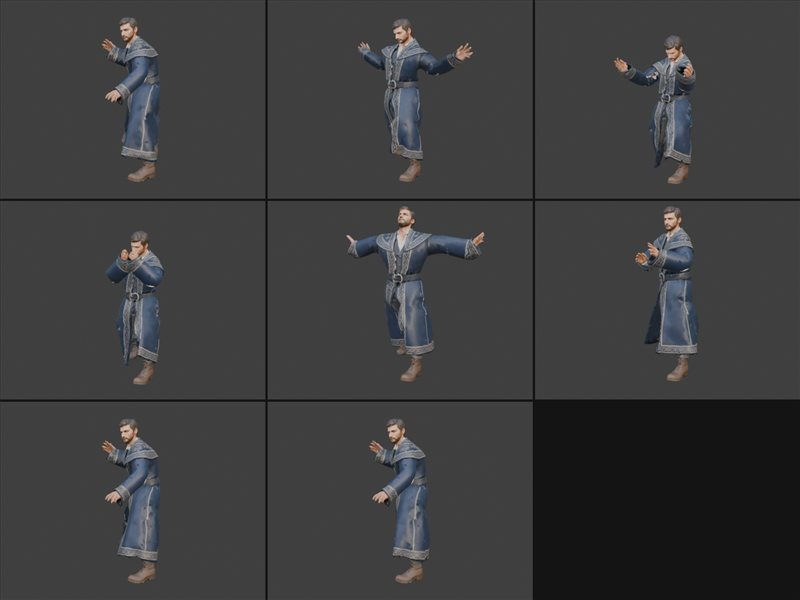

*19:04 새 로브를 입힌 Player에 마법 공격 동작을 입혀 본 장면(팔 모으기·교차·펼치기)*

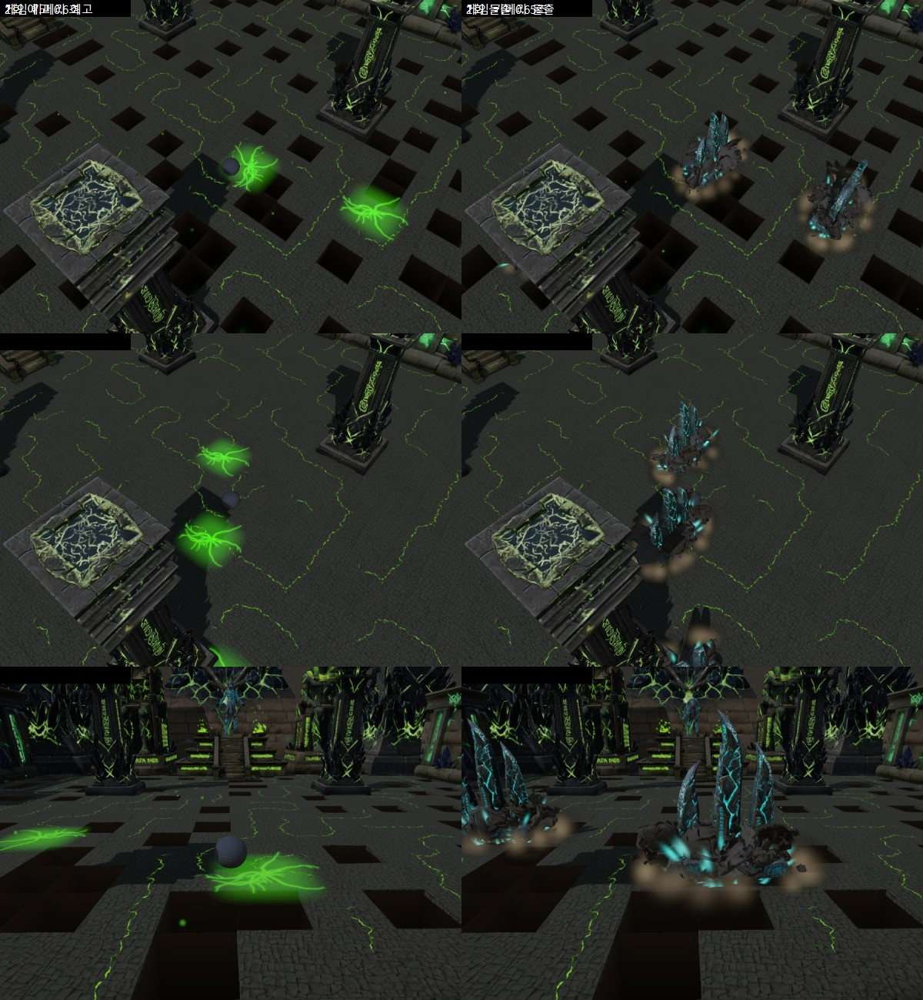

*12:21 패턴 B 함정 3곳. 왼쪽: 예고 0.6초(연두색 균열 세 곳), 오른쪽: 시전 0.65초에 세 곳에서 동시에 솟음. 위 두 줄은 위에서 본 화면(두 번의 시전), 아래는 게임 카메라*

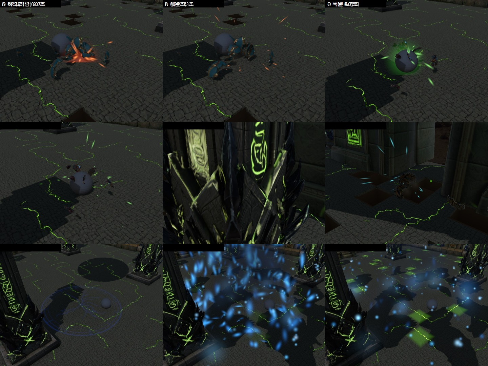

*12:12 위: A가 바닥에 닿아 깨짐(0.07·0.25초 뒤), C가 목표에서 터짐. 가운데: C 0.25초 뒤, E가 정문 벽에 닿아 부서짐(두 번째 칸은 카메라가 기둥에 가림). 아래: D 파란 예고(2.0초), 파편이 투명해지는 중(5.3초), 거의 사라짐(6.2초)*

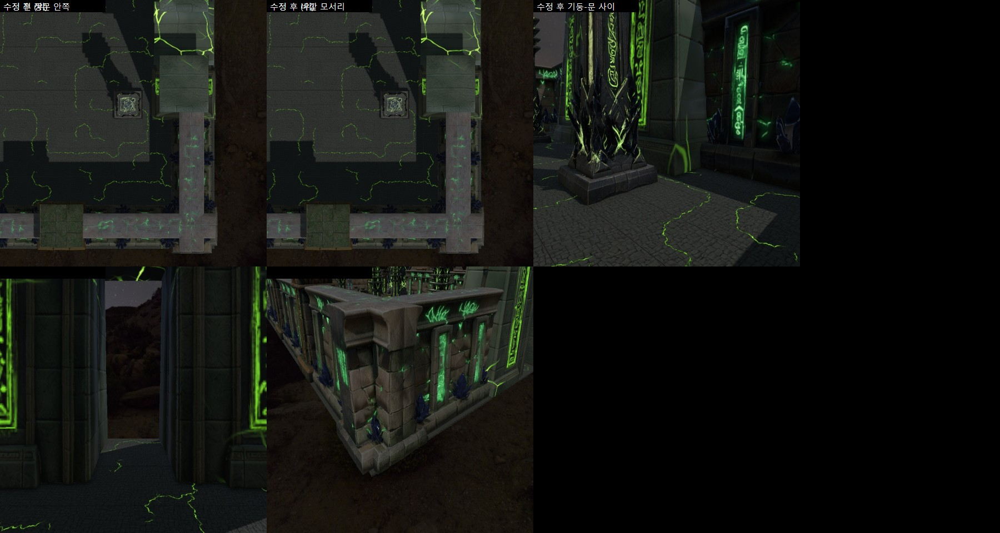

*11:47 위: 수정 전과 후를 위에서 본 화면(탑문과 오른쪽 끝벽이 한 칸 바깥으로 나가 제드기둥과의 사이가 넓어짐), 제드기둥과 탑문 사이 통로. 아래: 정문 안쪽, 바깥 모서리(끝벽이 옆벽 끝을 덮어 구멍 없음)*

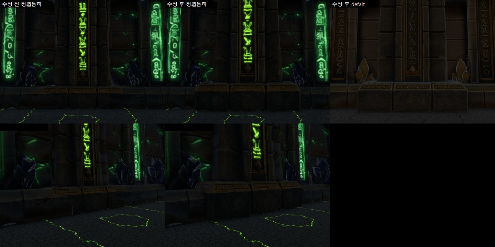

*11:42 벽 Pillar 수정 전후. 왼쪽 위·아래가 수정 전(받침이 벽 받침 줄과 같은 면에 묻혀 겹쳐 보임), 가운데가 수정 후(받침이 앞으로 나와 별도 블럭으로 읽힘), 오른쪽 위는 defalt 세트*

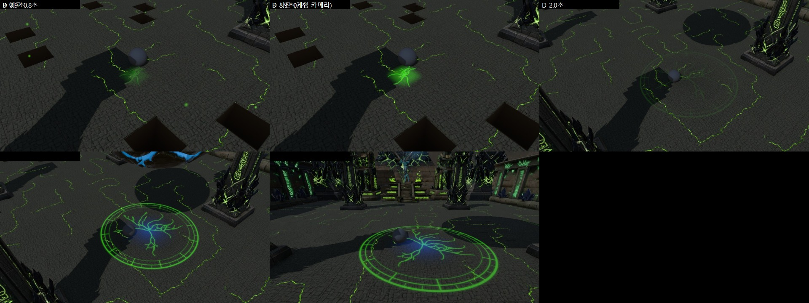

*11:34 impe 스타일 예고. 위: B 예고 0.8초(균열이 퍼짐), B 시전 0.4초(가장 밝음), D 2.0초(옅은 문양과 그림자). 아래: D 3.9초(문양·균열이 밝고 중심에 파란 열기, 태양 그림자가 짙음), 같은 순간 게임 카메라*

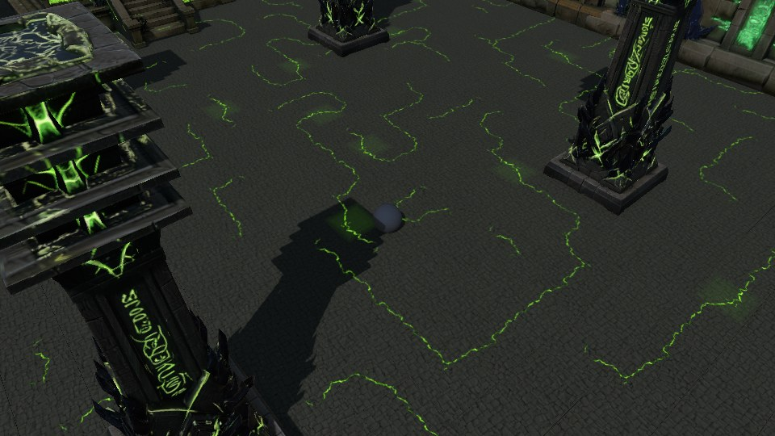

*11:34 호루스 타일 붕괴 경고 1.8초. 깨질 타일의 균열이 연두색으로 강하게 빛나고 타일은 은은하게만 밝아짐*

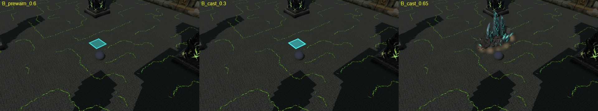

*11:10 패턴 B 예고. 시전 전 0.6초, 시전 0.3초(표시 유지), 0.65초(그 칸에서 함정이 솟고 표시는 꺼짐)*

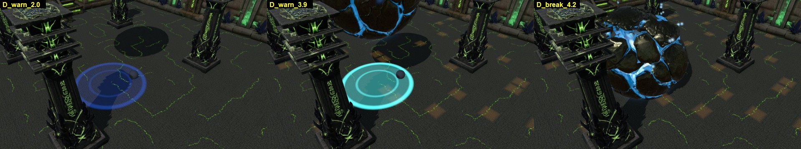

*11:10 패턴 D 예고. 2.0초 옅은 파란 원, 3.9초 밝게 맥동, 4.2초 원 위에서 태양이 깨짐(태양 그림자는 달빛 방향으로 비켜 보임)*

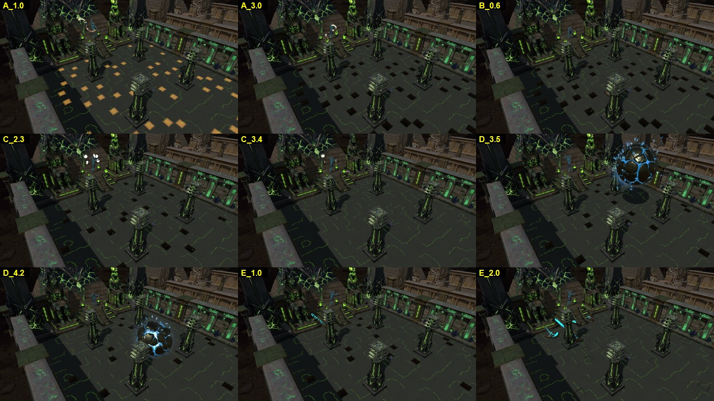

*11:10 Play 분석 캡처(위에서 본 화면). 패턴별 핵심 순간 A 1.0·3.0, B 0.6, C 2.3·3.4, D 3.5·4.2, E 1.0·2.0초*

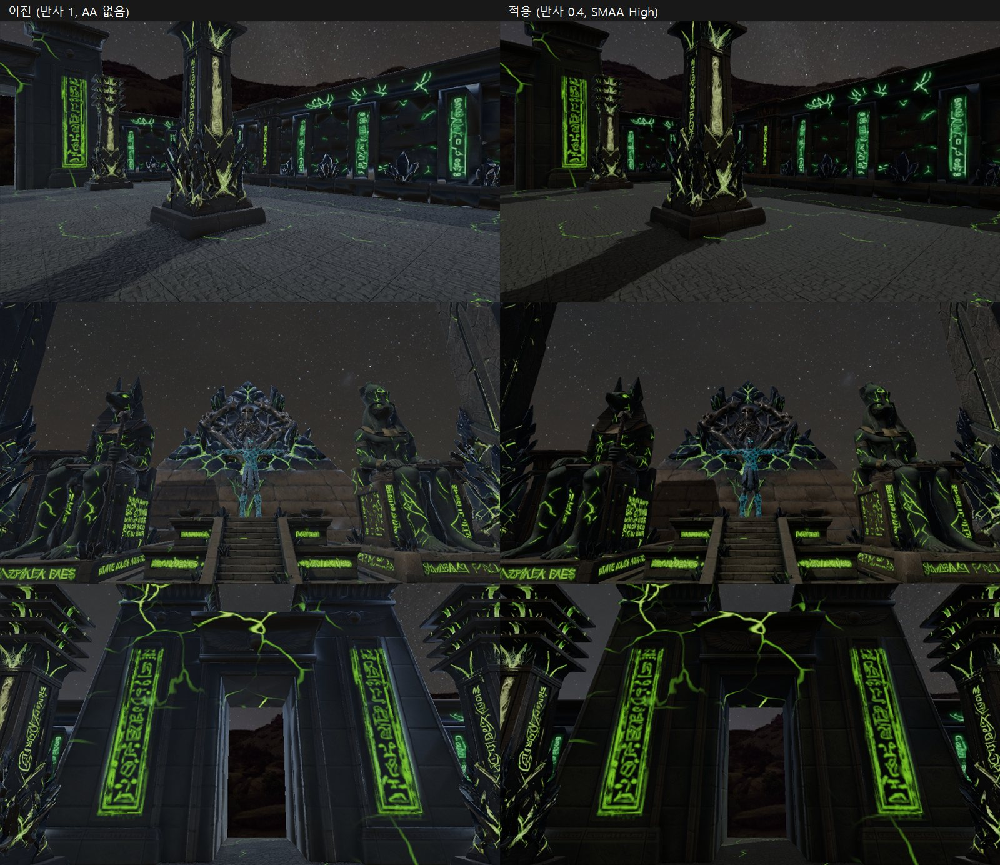

*10:00 왼쪽 이전(반사 1, AA 없음), 오른쪽 적용(반사 0.4, SMAA High). 위부터 기둥 그림자 바닥, 제단, 입구*

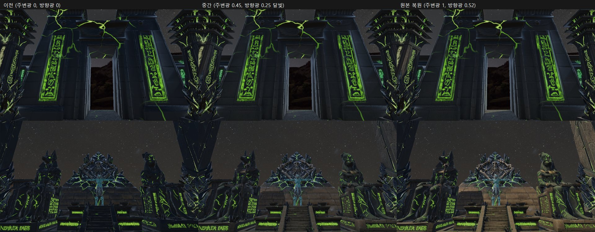

*09:40 조명 비교. 왼쪽 이전(주변광 0, 방향광 0, 회청색 번들거림), 가운데 적용한 중간 밝기, 오른쪽 원본 복원 값*

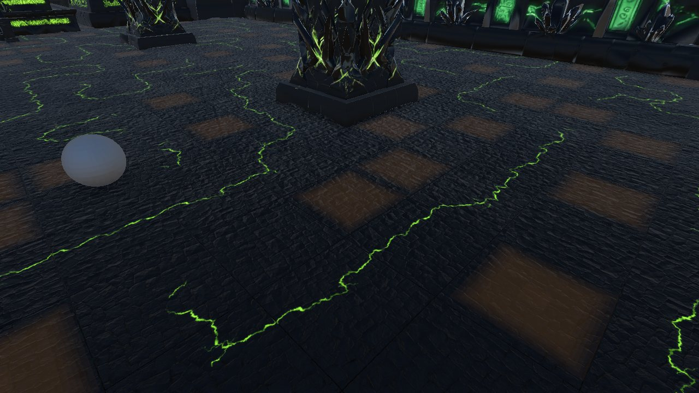

*09:10 경고 단계. 깨질 종류의 타일 전체가 은은한 호박색으로 빛남(균열이 없는 부분도 보임)*

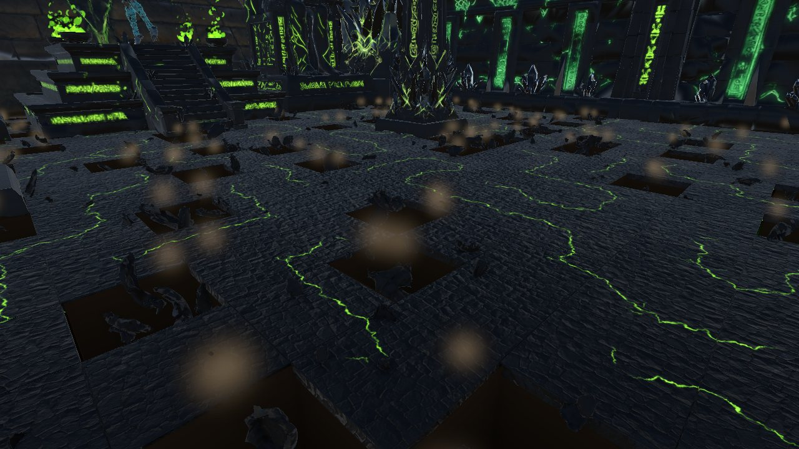

*09:10 붕괴 직후(슬로 모션). 사암 덩어리가 튀어 구덩이로 떨어지고 흙먼지가 퍼짐. 아래 맵 대신 어두운 구덩이가 보임*

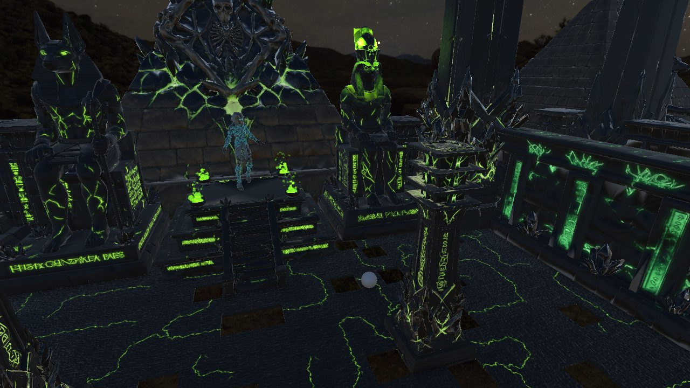

*08:50 타일 D가 깨져 바닥 곳곳이 비어 있는 순간. 오른쪽 호루스 석상 머리 양옆에 눈 발광*

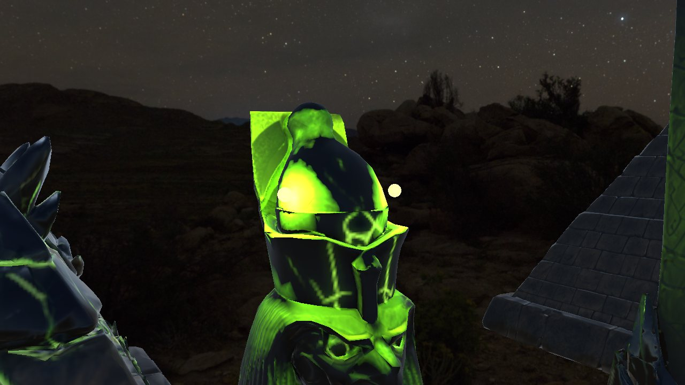

*08:50 호루스 머리 근접. 머리 양옆 눈 위치에 초록 발광 구체와 점광원*

## 메모
- 패턴 A~E 피격은 09:40부터 메시 콜라이더 기준으로 HP를 깎는다. C 보석만 피격 후 무적을 무시한다.
- 조명·반사·SMAA 값은 씬을 저장해야 유지된다(10:00 기준 미저장).
- 다음 후보: 반사 프로브 설치, 돌 거칠기 상향, E 줄 예고 표시.
- 점프로 구멍을 건너는 동작은 키 입력이 필요해 직접 조작으로 확인해야 한다.
