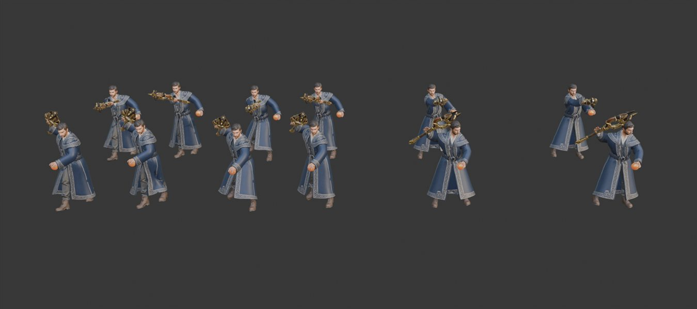
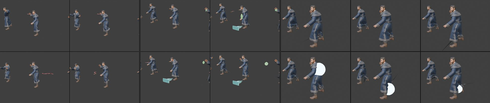
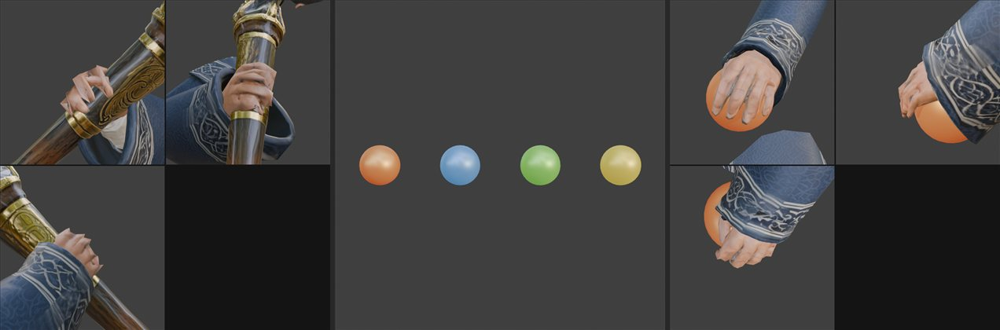
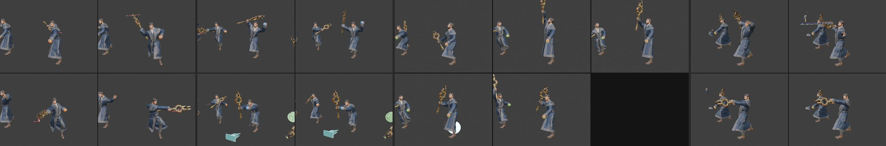
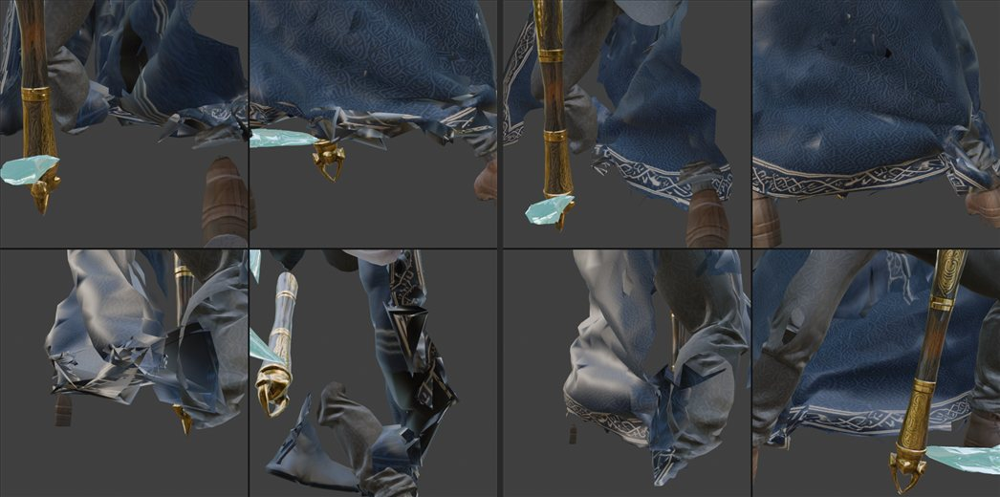
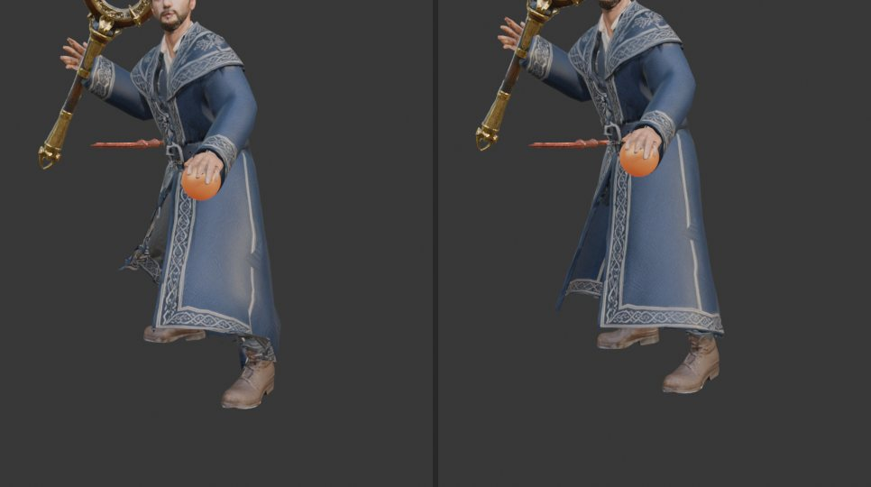
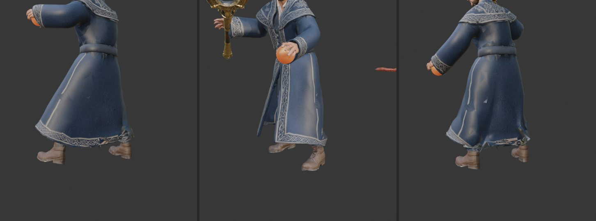
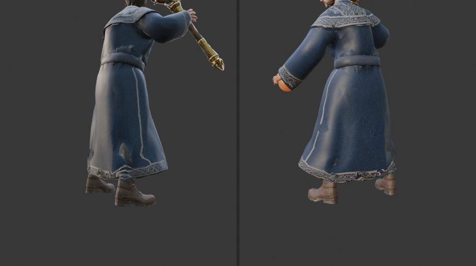
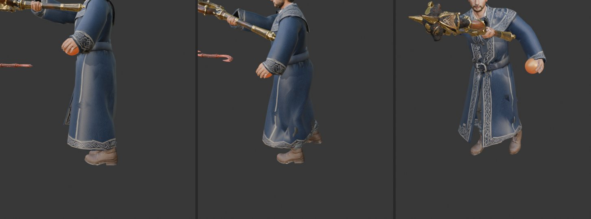
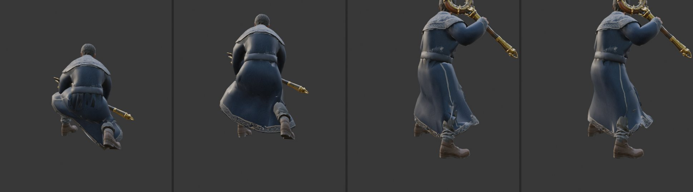

# 2026-11-13 (금) — Player 재활용 패턴·스태프·오브, 로브 Cloth와 동작 검수

[← History_Crash 개발 일지](../README.md)

Blender `Player.blend`에서 마법사 Player가 보스 패턴 A~E를 재활용하는 동작을 만들고, 로브(Cloth)가 동작마다 다리를 뚫거나 찢어지지 않도록 하나씩 검수했습니다.

| 시간 | 작업 | 결과 |
| --- | --- | --- |
| 08:53 | 팔꿈치 흰 돌출 수정 | 팔을 펼칠 때 팔꿈치 뒤로 흰 조각이 보이던 것은 의상이 아니라 몸(흰 셔츠) 팔꿈치가 소매를 뚫은 것. 소매 속 팔 정점 160개를 숨김 그룹(`Body_Hidden`)에 추가(손목 6cm 안은 소맷부리 틈 방지로 남김). 양쪽 팔꿈치 흰 조각 사라짐 |
| 08:58 | 새끼손가락 2개 → 자연스러운 손 | 몸 메시(VARCO 생성)에 손가락 조각이 덧붙어 있어 새끼를 굽히면 따로 움직여 두 개처럼 보였음(웨이트 문제 아님). 손가락 축에서 손바닥 쪽으로 7.5mm 넘게 튀어나온 정점 63개를 손가락 속으로 당겨 묻음(연결·UV 유지). 손가락 5개만 보임 |
| 09:15 | 플레이어 재활용 패턴 A~E | 보스 패턴 오브젝트 5종을 Player 크기로 줄이고(코페쉬 0.35·함정 0.36·보석 0.08·태양 0.30·창 0.70m, 키 1.0 기준), 베이스 컬러·발광을 속성색으로 바꾼 `<원본>_Player`. 체크용 세트 5개(`Player_Patten_A~E`, 1.4m 간격)에 Lite Magic Pack 동작을 매칭: A 주위 휩쓸기, B 전방 트랩, C 5연발, D 자기 위치 낙하, E 전방 관통 창 |
| 09:33 | 아누비스 스태프·속성 오브 쥐기 | 오른손에 `Anubis_Staff_Player`(0.72m, 손잡이 = 아래에서 40%)를 쥐고 손가락 쥐기. 왼손에 오브 4종(지름 7.5cm): 불(빨강)·물(파랑)·풀(초록)·전기(노랑)를 A~D 세트에 배치. 패턴 오브젝트는 손 대신 스태프 머리에서 나오도록 타이밍 조정 |
| 09:50 | 밑단 흩날림 수정, 스태프용 애니메이션 교체 | 밑단 조각이 흩날리던 원인: 안감·테두리 두 겹이 Cloth 메시의 엉뚱한 면에 연결됨 → 허리 아래 안감 면 2,885개 삭제, Surface Deform 대신 지오메트리 노드 `ClothFollowGN`(정점마다 대응하는 Cloth 정점 번호·오프셋)으로 교체. 로브 최대 늘어남 38 → 10배. 스태프를 든 채 어울리는 동작을 `Magic Spell Pack`에서 찾아 교체(A 휘두르기, B 내려찍기, C 겨누기, D 하늘로 들기, E 창처럼 찌르기) |
| 09:58~10:03 | 재생 60fps 안정화 | Cloth 디스크 굽기, 몸 Mask 대신 가려진 정점을 지운 몸 메시(5,065정점). 사용자 화면에서 9.67fps(동기화 77ms)로 다시 측정 → 원인은 Material 미리보기에서 움직이는 노멀맵 로브의 접선 재계산(로브당 약 8ms). 화면용 로브 `mesh_0_Fit_Lite`(15,618 삼각형)와 몸 커스텀 노멀 삭제로 한 세트 57.9fps(5세트 동시 23.7fps) → 한 세트씩 보기로 결정 |
| 10:56~11:21 | 패턴 C 재구성(v3) | 소환 → 정면 조준 → 5연발. 발사마다 팔을 다시 휘두르지 않고 짧은 반동만, 고개는 정면 고정(오차 0.3°), 보석은 머리 위 반원에 떠 있다가 차례로 발사. 스태프가 몸을 뚫는 점을 프레임마다 재서 손목 각도 격자 + 부드러운 경로 최적화로 수정(283 → 0~15점). 하체를 하나의 정면 스탠스로 통일해 발 미끄러짐 제거 |
| 11:32 | 캐스트 속도·이동·피격·이동 중 캐스팅 | A·B·D·E 시전 1.4배 빠르게(`*_fast`). Lite Magic Pack에서 앞·뒤 걷기, 작은·큰 피격을 리타깃. 옆걸음은 파일이 없어 직접 키(33프레임 1주기). 하체=이동·상체=C v3를 합친 이동 중 캐스팅 4방향(`Player_CastC_Move_*`) |
| 11:58~12:00 | Blender 튕김 복구, 장면 정리 | Cloth 굽기 중 Blender가 튕겨 자동저장본으로 복구. 몸 충돌이 꺼진 채 Cloth가 굽혀져 있던 것을 발견해 굽는 동안만 켜도록 정리. 쓰지 않는 원본·시안 오브젝트 116개 삭제(파일 228 → 149MB). 이후 동작 검수는 A 세트 하나에 액션을 바꿔 가며 하나씩 진행 |
| 12:06~12:18 | 검수 1 앞으로 걷기: 자락 말려 올라감 | 몸 충돌을 켜니 걸을 때 자락이 무릎까지 말려 올라감 → 자락 고정·질량·굽힘을 올리고 몸 마찰 3 → 0.5(다리가 천을 끌어 올리지 않고 미끄러지게), 밑단 상승 11~12cm → 1~5cm. 뒤로 뻗은 종아리가 뒷자락을 뚫던 것은 로브 마지막 단계에 몸 기준 3mm 밀어내기(`LegPushOut`) |
| 14:01~14:08 | 진행 상황 정리와 복구본 전환 | 재시작으로 12:06~12:18 수정이 열린 파일에 없음을 확인 → 임시 자동저장본에서 찾아 `Player.blend`로 저장. 깨져 있던 패턴 텍스처 경로 17개 수정 |
| 14:31 | 걷기 중 로브 관통 수정 | 원인: 원본 걷기의 보폭·무릎 들림이 커서 앞트임 사이로 정강이가 나오고, 밀어내기가 앞자락까지 다리에 붙여 겹쳐 그려짐. 로브용 걷기 `Player_Move_Forward_Robe`(허벅지 60%·무릎 70%·발 80%, 발이 바닥에 닿도록 엉덩이 높이 보정) + 밀어내기는 뒷자락에만. 반복 재생 구간은 로브가 깨지지 않는 한 주기(11~78) |
| 14:53 | 검수 2 뒤로 걷기 | 다리 노출 측정 기준을 만듦(4방향 카메라에서 밑단 4cm 위 다리가 로브보다 먼저 보이는 횟수). 60·70% → 173, 45·55·70% → 21로 `Player_Move_Back_Robe` 채택, 반복 구간 18~89 |
| 15:00 | 검수 3 옆걸음 | 노출 왼쪽 1·오른쪽 5, 스태프 관통 0 → 수정 없이 통과. 반복 구간 왼쪽 19~50, 오른쪽 44~75 |
| 15:05~15:10 | 검수 4·5 작은·큰 피격 | 다리를 앞뒤로 크게 벌리고 버티는 자세라 앞트임 사이로 다리가 보임. 다리를 줄인 로브용 액션으로 작은 피격 노출 152 → 30, 큰 피격 188 → 23(휘청임은 유지) |
| 15:12~16:35 | 로브 밑단·옆트임 찢어짐 | 원인: 로브 정점마다 가장 가까운 Cloth 정점 하나를 따라가 이웃 정점이 따로 움직임. 이동량 평균(지오메트리 노드)은 A·C에서만 효과가 있고 동작이 큰 D·E에서는 오히려 악화 → 회전을 고려하는 Corrective Smooth(`HemSmooth`, 0.5·10회)를 Cloth를 따라가는 치마 전체에 적용. 밑단 늘어난 변 A 17~22, C 2~5, D 41 → 4~7, E 64~80 → 1~5, 프레임당 계산 9.2ms |
| 16:06 | 검수 6 이동 중 캐스팅 | 옆 2종은 통과. 앞·뒤는 다리 노출(179·143)과 시전 구간 스태프 뒤끝이 가슴·오른팔을 뚫음 → 다리 45·55·70% 축소 + 시전 구간 오른손을 바깥 25°·아래 15° 돌림(26~34프레임에 서서히). 노출 50·68, 스태프 관통 0 |
| 16:14~16:35 | C·D·E Cloth 다시 굽기, E 웅크림 수정 | 몸 충돌을 켜고 C·D·E 다시 굽기. E 깊은 웅크림에서 허리 뒤 천이 줄무늬처럼 늘어남 → 원인은 벨트(Spine 88%) 바로 아래가 8cm 안에 허벅지(74%)로 급히 바뀌는 웨이트. 허벅지 웨이트를 위로 갈수록 골반으로 넘기고, E에 다리를 줄인 로브용 액션 적용 → 늘어난 변 632 → 408, 줄무늬 사라짐 |
| 17:27 | 이동 동작 변형 12세트 배치 | 검수용으로 A 세트(스태프·불 오브)를 변형마다 복제해 종류별로 배치: 앞줄 걷기, 뒷줄 이동 중 캐스팅, 칸은 방향(앞·뒤·왼쪽·오른쪽). 앞·뒤 칸에는 원본과 로브용(다리 축소) 액션을 나란히 둬 비교. 세트마다 Cloth를 따로 구움(몸 충돌 켜고 1~110프레임) |

## 렌더 체크

*17:27 이동 동작 변형 배치(45프레임). 앞줄 걷기, 뒷줄 이동 중 캐스팅. 왼쪽부터 앞(원본·로브용), 뒤(원본·로브용), 왼쪽, 오른쪽*

*09:15 재활용 패턴 체크 세트. 왼쪽부터 A 휩쓸기(빨강), B 전방 트랩(청록), D 낙하(백청)*

*09:33 오른손 스태프 쥐기, 오브 4종(불·물·풀·전기), 왼손 손바닥에 올린 오브*

*09:50 스태프용 동작. 왼쪽부터 A 휘두르기, B 내려찍기, D 하늘로 들기, E 창처럼 찌르기(위·아래는 서로 다른 프레임)*

*09:50 왼쪽 수정 전(밑단 조각이 흩날림), 오른쪽 수정 후*

*15:05 작은 피격 60프레임 정면. 왼쪽 원본(앞트임 사이로 다리가 드러남), 오른쪽 로브용 액션*

*15:10 큰 피격 로브용 액션 20·50·78프레임. 휘청이는 동작은 유지하고 다리는 자락 안에*

*15:12 큰 피격 81프레임 뒤·옆. 밑단 가장자리의 뾰족한 실밥 모양이 사라짐*

*16:06 왼쪽 원본(스태프를 앞으로 수평하게 들어 뒤끝이 가슴을 뚫음), 가운데·오른쪽 수정 후(스태프 끝을 바깥으로 겨누는 자세)*

*16:35 왼쪽 두 장: E 55프레임 수정 전(허리 뒤 줄무늬)·후. 오른쪽 두 장: D 115프레임 수정 전(옆트임 테두리 조각)·후*

## 메모

- 로브는 Blender Cloth를 Unity로 그대로 가져갈 수 없어, Unity Cloth로 다시 설정하거나 애니메이션으로 굽는 방법을 정해야 합니다.
- 동작마다 원본은 그대로 두고 로브에 맞게 다리를 줄인 `_Robe` 액션을 따로 만들었습니다.
