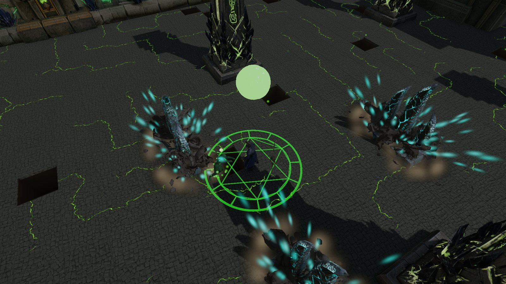
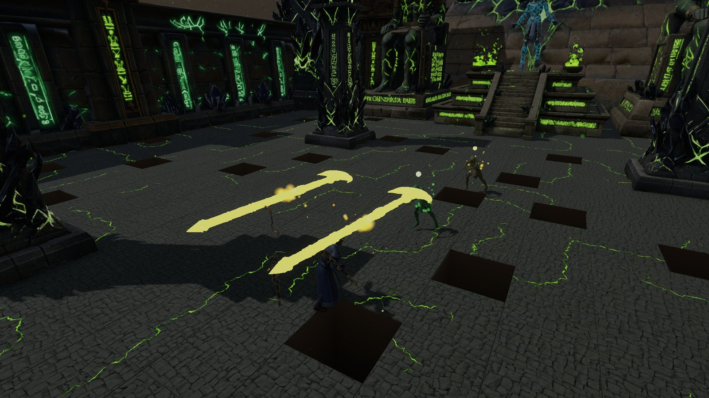
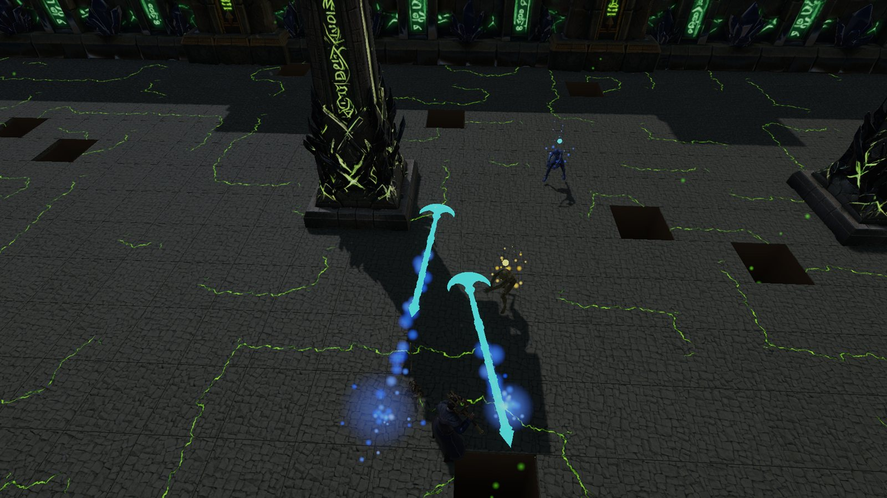
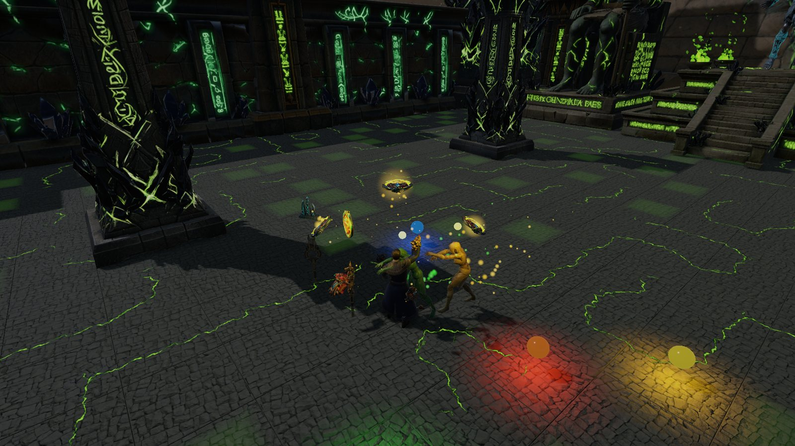
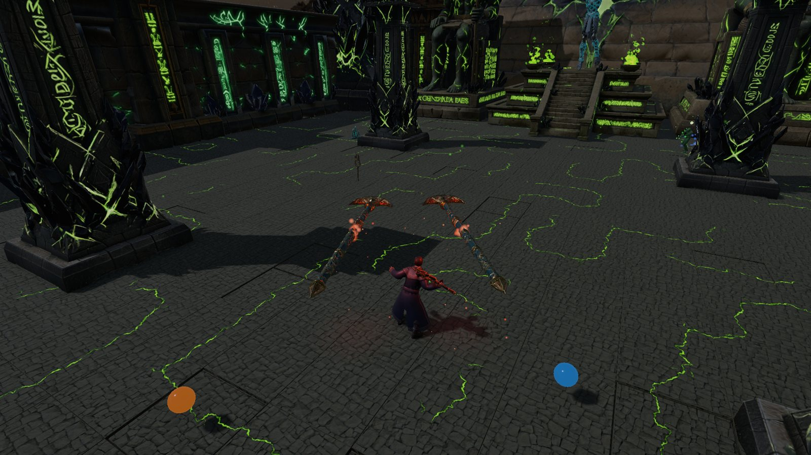
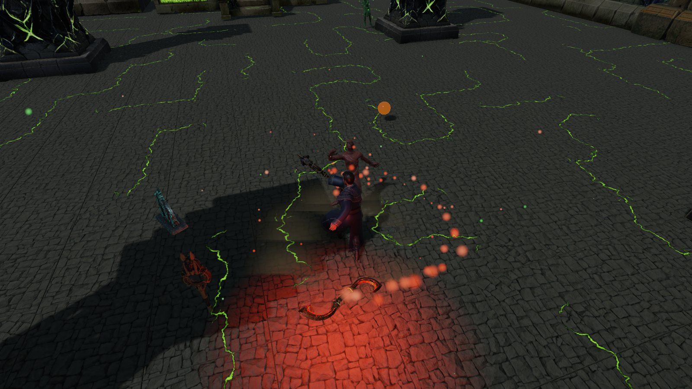
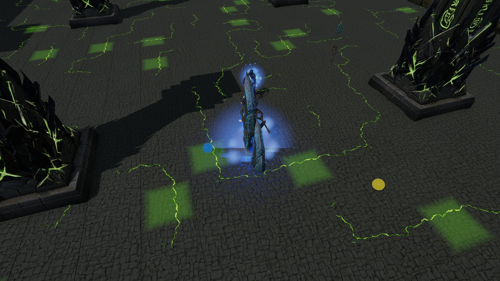
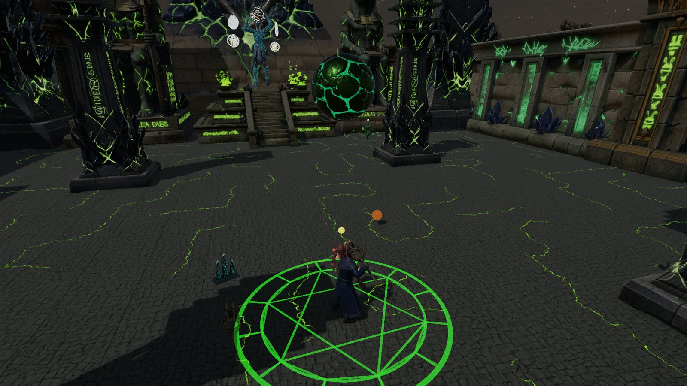
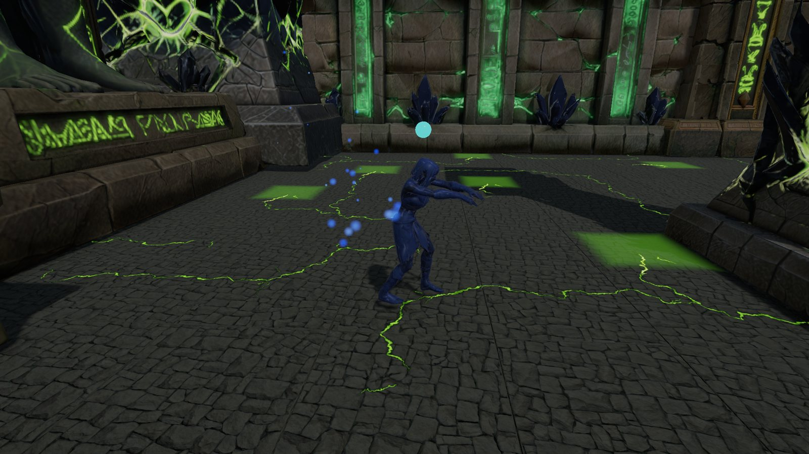

# 2026-11-16 (월) — Unity 플레이어 스킬 A~E 검증·연출, 속성 표현, 시전 모션·미라 이동

[← History_Crash 개발 일지](../README.md)

Unity 테스트 프로젝트에서 Player가 주운 스태프로 쓰는 약화판 패턴 공격 A~E를 하나씩 검증했습니다. 연출을 보스 패턴에 맞게 다시 만들고, 시전 모션이 잘리는 문제와 미라의 걸음·방향 문제를 고쳤습니다.

| 시간 | 작업 | 결과 |
| --- | --- | --- |
| 16:08 | A 근접 회전 검증 | 같은 속성 미라가 시전 0.62초에 사망. 시전 1.03초에 이동 복귀 |
| 16:10~16:15 | B 함정 범위 | 처음 범위(0.55 m)가 너무 좁음 → 1.8 m는 작고 2.8 m는 너무 커서 **2.3 m**(메시 2.8)로 확정. 함정 중심 2.0 m 거리의 미라가 밟자 0.14초에 사망 |
| 16:19~16:23 | C 보석: 주위 사출 → 순차 발사 | 보석 3개가 가슴에서 튀어나와 좌·위·우에 떠 있다가, 0.18초 간격으로 정면을 향해 발사. 사출 시간(0.44초)만큼 먼저 시전해 첫 발사를 모션의 발사 시점에 맞춤 |
| 16:25~16:31 | D 태양: 지연 낙하 + 범위 마법진 | Player 머리 위에 오브가 생겨 0.55초 떠 있는 동안 바닥에 타격 범위(1.4 m)만 한 마법진이 그려짐. 바깥 고리 = 실제 타격 범위. 낙하가 가까울수록 빠르게 깜빡이고 착탄 때 번쩍임 |
| 16:29~16:50 | E 창: 좌우 2개 소환 → 교차 사출 | 창 1개(파라오 창의 절반 4.85 m)로 만들었으나 너무 큼 → 2.4 m로 축소. 거꾸로 나오던 방향 수정(넓은 날이 앞으로). 머리 위는 너무 높아 허리 높이(1.0 m)에 좌우 1개씩 배치. 정면 4 m 지점에서 X자로 교차(각 8.5°) |
| 16:48 | 탄환 건너뛰기 수정 | 프레임이 튀면 창이 한 프레임에 수 m를 이동해 미라를 지나치던 문제. 한 프레임 이동을 판정 반경 이하로 나눠 판정. 긴 탄은 창끝과 몸통 둘 다 판정 |
| 16:53~17:03 | 속성 표현 방식 변경 | 공격 오브젝트를 속성색 단색 발광으로 덮어 텍스처가 사라지던 문제. 파라오 패턴처럼 원래 텍스처 재질을 유지하고 속성색 점광원만 더함(바닥을 물들이지 않게 범위 0.8~1.6 m). A·B·D는 밝은 무늬만 속성색으로 빛나도록 재질 복사본에 발광 틴트. 미라 오브는 어두운 보석 재질로 바꾸고 점광원 제거 |
| 17:15 | 시전 모션 잘림 + 이동 중 시전 | 시전 모션이 45~55%에서 끊기고 걷기로 넘어가던 문제 → 끝(95%)까지 재생한 뒤 걷기로. 시전 중 이동 허용(속도 60%), 이동 중이면 4방향 이동 시전 모션 사용. 사용자 직접 플레이로 검증 |
| 17:22 | 미라 걸음 미끄러짐 | 걷기 클립 보폭이 0.16 m/s인데 이동은 2.4 m/s, 배속 상한 3배 → 다리가 미끄러짐. 중간값으로 이동 1.0 m/s, 배속 상한 6.5배 |
| 17:45 | 미라 pivot 수정 | 프리팹 안 모델이 23.25° 돌아간 채 저장돼 미라가 비스듬히 걷고 엉뚱한 쪽을 봄 → 회전 0으로. 진행 방향과 몸 방향 차이 23° → 0° |

## 렌더 체크

*16:31 D 시전 중. 바깥 고리 반지름 = 타격 범위 1.4 m*

*16:47 E 창 2개가 Player 좌우(높이 1.0 m)에 떠서 정면을 겨눔*

*16:49 사출 직후. 좌우 창이 안쪽으로 기울어 정면 4 m 지점에서 교차*

*16:55 C 보석이 앙크 보석 원래 텍스처로 보임(속성은 은은한 빛). 아래 오브 2개는 광원 제거 전*

*16:56 E 창이 파라오 지팡이 청동 텍스처로 보임. 오브의 바닥 물들임 사라짐*

*17:00 A 코페쉬 날이 불빛으로 빛나고 불 파티클이 따라감*

*17:00 B 함정 석재 텍스처 위 물 속성 푸른 기운*

*17:02 D 태양 표면의 핏줄 무늬가 풀 속성 초록으로 빛남(돌 명암은 유지)*

*17:45 수정 후 미라가 진행 방향을 정면으로 보며 걸음*

## 메모

- glTF 패턴 셰이더는 발광 세기가 약하면 원래 청록 무늬에 묻힙니다. 베이스 색에도 속성색을 일부 곱해야 보입니다.
- 스킬 오브젝트의 방향·위치 기준은 발사 순간의 카메라 정면입니다. 시전 중 카메라를 돌리면 조준도 따라갑니다.
- 플레이 중 스크립트가 재컴파일되면 시전 코루틴이 끊겨 시전 상태가 굳습니다. 테스트 전 플레이 모드를 껐다 켭니다.
