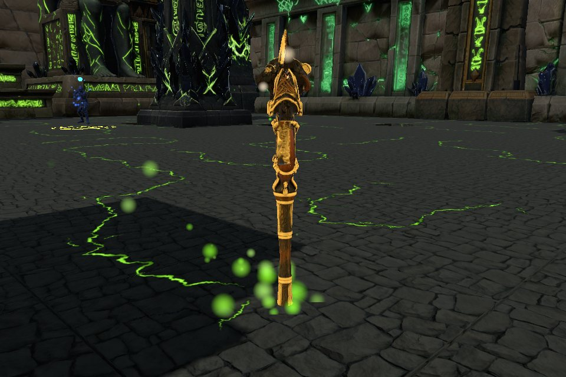
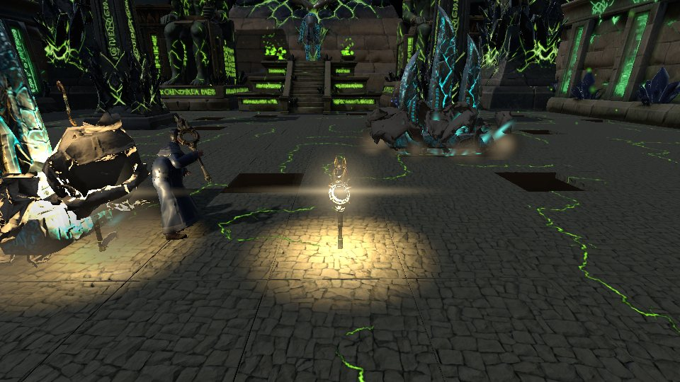
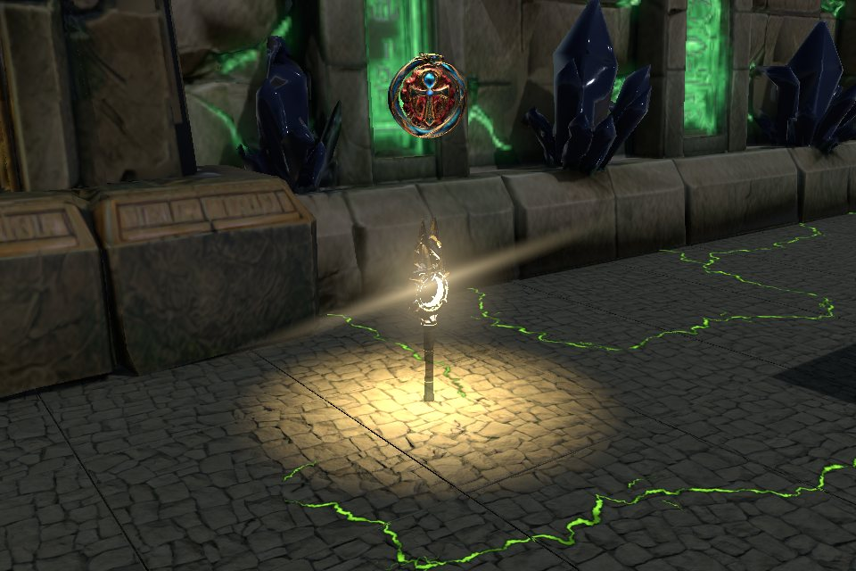
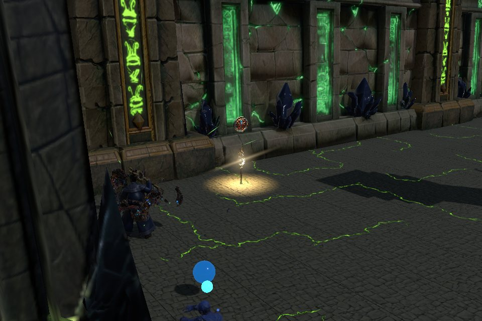
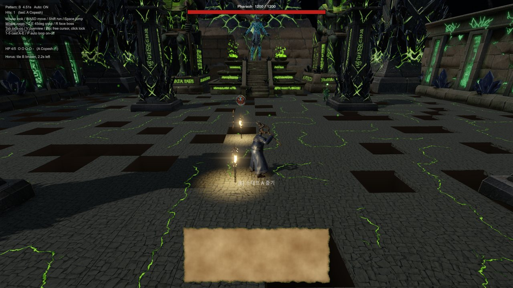
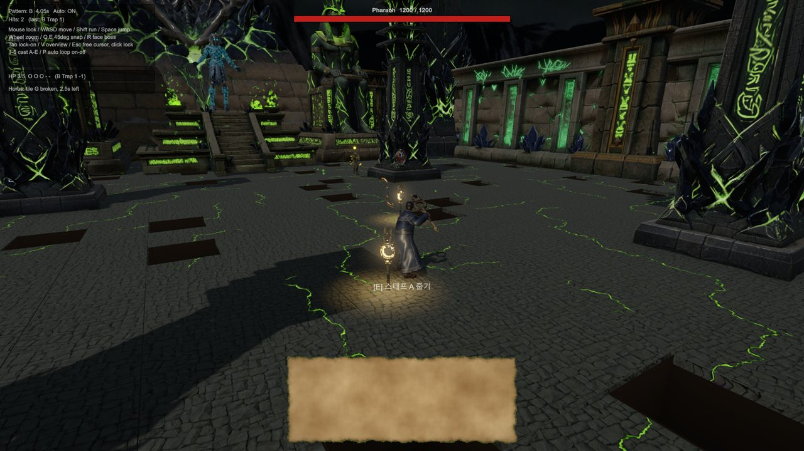
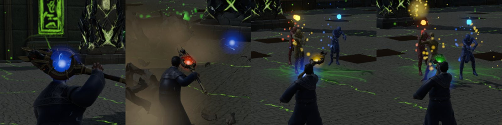
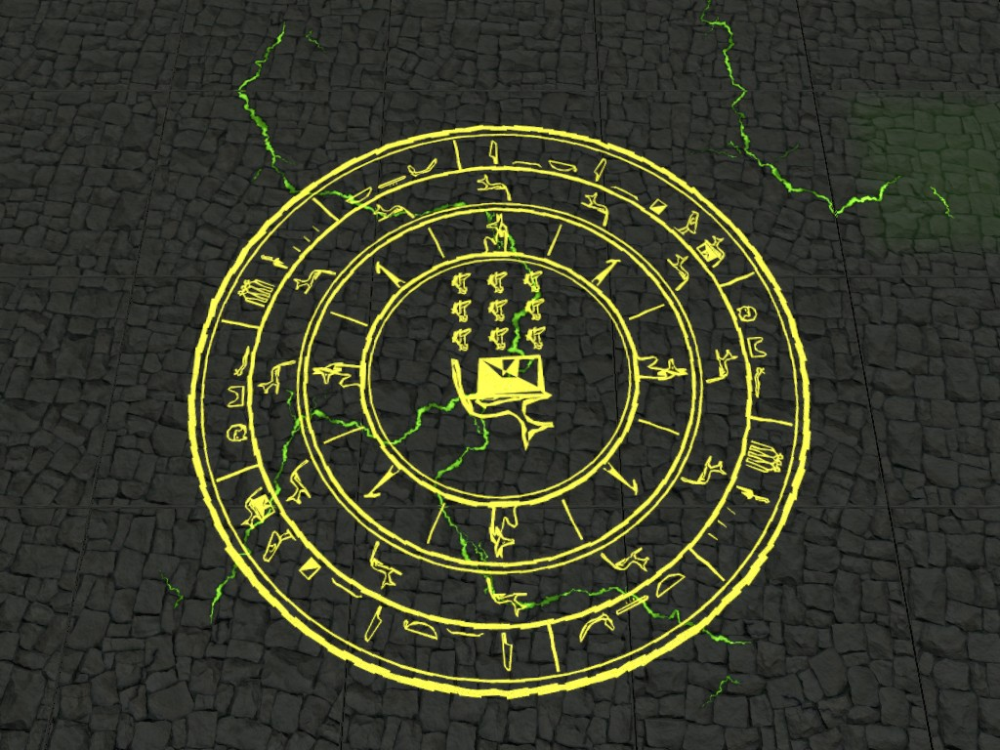
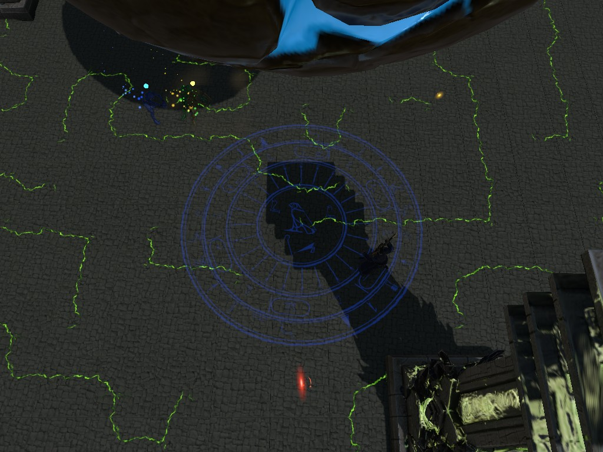
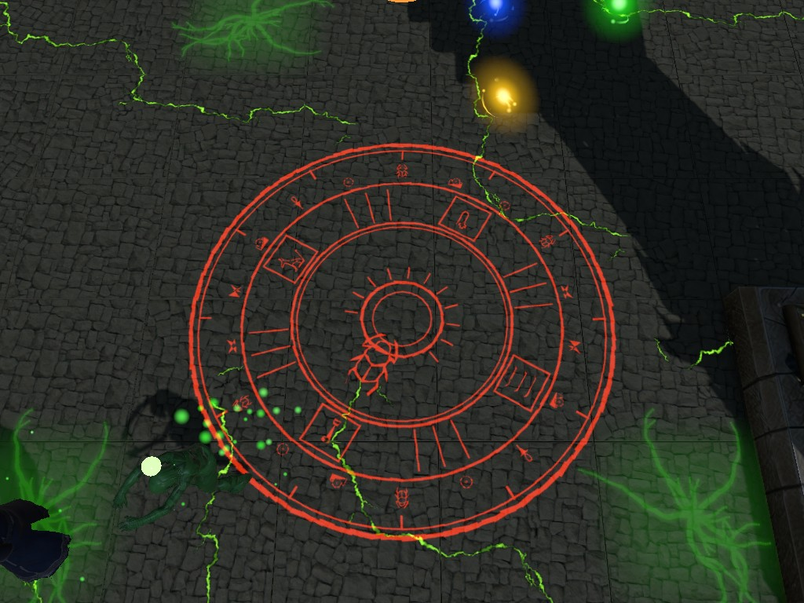

# 2026-11-18 (수) — 팀 프로젝트로 이관, 깨진 참조 복구, 팀원 환경 정리, 드랍 스태프 가시성

[← History_Crash 개발 일지](../README.md)

테스트 프로젝트에서 만든 씬과 에셋을 팀 프로젝트로 옮기면서 생긴 깨진 참조를 원인별로 복구했습니다. 팀원들이 같은 작업 환경을 갖추도록 설치 목록과 Claude용 세팅 프롬프트도 정리했습니다(11-17 저녁 작업 포함). 오후에는 보스 패턴 뒤에 떨어지는 스태프가 잘 보이도록 위치 표시 연출을 샘플 5가지로 비교해 하나를 골랐습니다.

| 시간 | 작업 | 결과 |
| --- | --- | --- |
| 11-17 17:28 | 씬 단일 패키지 | `TEST_JMC` 씬 + 의존 에셋 336개를 원래 GUID 그대로 `.unitypackage` 하나로 |
| 11-17 17:3x | 깨짐 원인 정리 | FBX가 깨지는 원인 = `.meta` 없이 복사돼 GUID가 바뀜. 머티리얼 재매핑·Missing Script 복구용 에디터 스크립트와 패키지 이관 가이드 작성 |
| 11-17 17:55~18:20 | 검증용 프로젝트로 이관·검증 | 원본 Assets 전체(906개)를 패키지로 → 받는 프로젝트의 `HIS` 폴더 아래로 이동(GUID 유지). 씬 4·프리팹 87개 검사 결과 Missing Script·빈 머티리얼·빈 메시 모두 0. 패키지 경로를 직접 바꿔 다시 묶는 방법은 Unity가 0개로 가져와 실패 → 원본 패키지를 가져온 뒤 Unity 안에서 이동하는 방식으로 해결 |
| 08:51~09:08 | 팀 프로젝트 Unity MCP 연결 | 계속 "Connection revoked"로 거부 → 원인은 이 프로젝트의 Unity MCP 설정에 `claude-code` 항목이 Rejected로 저장된 것. 승인은 프로젝트마다 따로 저장됨. Accept로 바꾼 뒤 연결 |
| 09:09~09:12 | 바닥·석상이 비어 보임 | `TEST_JMC` 빈 메시·빈 머티리얼 1,169개 → 원인: `.gltf` 모델 8개를 읽는 glTFast 패키지가 팀 프로젝트에 없음(`.unitypackage`에는 패키지 설치 정보가 들어가지 않음). glTFast 6.20.0 설치 후 0개 |
| 09:13~09:16 | 보스 패턴·미라·아누비스 기믹 멈춤 | 씬이 쓰는 패턴 프리팹 5개가 팀 프로젝트에 없어 Missing Prefab → 보스 패턴 디렉터가 시작할 때 오류로 꺼지고, 패턴 사이에 일어나는 미라 소환·아누비스 기믹도 함께 멈춤. 프리팹 5개를 원래 GUID 그대로 `Art/Prefabs/JMC`에 추가해 Missing Prefab 0 |
| 09:2x | 팀원 설치 목록·세팅 프롬프트 | 직접 받을 것: Unity 6000.3.26f1, Git, DOTween. 자동 설치: Unity 패키지 14개, Git 패키지 3개(R3·UniTask·NuGetForUnity), NuGet DLL 5개. 팀원이 Claude에 붙여 넣어 같은 환경을 만들고 검증하는 프롬프트 작성 |
| 09:3x | Art 폴더 패키지 | Art는 git에서 제외되므로 패키지로 전달. 의존성 포함을 꺼서 Art 항목 500개만 담음(git의 스크립트를 덮어쓰지 않게). Art 밖 의존은 스크립트·URP 설정뿐이고 둘 다 git에 있음 |
| 09:4x | 저장소 링크 404 | 공유한 주소 끝에 백틱(`%60`)이 붙어 없는 저장소로 열림. 주소만 다시 전달하고 문서 링크 수정 |
| 14:3x~15:3x | 드랍 스태프 가시성 | 바닥에 박힌 스태프가 잘 안 보여 찾기 어려움 → 위치 표시 샘플 5가지를 번호로 만들어 비교한 뒤 **스포트라이트 + 블룸** 채택(아래 표). 나머지 샘플 코드는 정리 |

## 드랍 스태프 위치 표시 샘플

보스 패턴이 끝나면 그 자리에 스태프가 떨어져 바닥에 박히고, Player가 다가가 줍습니다. 그런데 신전 바닥이 어둡고 초록 균열이 많아 박힌 스태프가 잘 보이지 않았습니다. 그래서 위치를 알리는 연출을 번호를 붙인 샘플로 하나씩 만들고 비교했습니다.

| 번호 | 샘플 | 내용 | 결과 |
| --- | --- | --- | --- |
| 1 | 빛기둥 | 스태프 위로 6 m 금색 기둥. Player가 가까이 오면 옅어짐 | 멀리서 가장 잘 보임 |
| 2 | 초록 불꽃 | 발밑에서 약 1.5 m 초록 불꽃과 불티 | 신전 분위기와 잘 섞이지만 바닥 균열도 초록이라 대비가 약함 |
| 3 | 스포트라이트 | 위에서 아래로 비추는 조명 | **채택**(아래에서 다듬음) |
| 4 | 금빛 발광 | 스태프 재질 자체를 금처럼, 무늬를 따라 금빛이 일렁임 | 덧붙이는 오브젝트가 없지만 멀리서는 작게 보임 |
| 5 | 금빛 + 박힌 자리 불꽃 | 4번에 더해 박힌 지점에만 작은 초록 불꽃 | 불꽃 크기를 과함 → 너무 작음 → 은은함 → 조금 진하게 순서로 조정 |

### 채택: 스포트라이트 + 블룸

처음 스포트라이트는 바닥이 지름 약 2.1 m로 넓게 밝아졌습니다. 피드백("범위를 줄이고, 스태프 위치에서 가장 쨍하게, 옆으로 블룸")에 따라 다음처럼 바꿨습니다.

- **좁은 조명:** 각도를 34°에서 16°로, 높이를 3.5 m에서 2.8 m로 줄였습니다. 가장자리를 넓게 흐리게 해서 가운데만 밝고 바깥으로 갈수록 어두워집니다.
- **스태프가 가장 밝게:** 스태프 중심에 작은 점광원(범위 1 m)을 두었습니다.
- **옆으로 번지는 블룸:** 스태프 중심에 둥근 빛무리와 가로로 긴 빛 줄기를 가산 합성으로 겹쳤습니다. 두 판은 항상 카메라를 보고, 줄기는 화면에서 늘 가로입니다. 화면 전체 후처리 블룸은 다른 오브젝트까지 번지므로 쓰지 않았습니다.
- 박힌 뒤 0.4초에 걸쳐 켜지고 약하게 맥박치며, 스태프가 사라질 때 함께 흐려집니다.

| 게임 화면 | 가까이 | 멀리 |
| --- | --- | --- |
|  |  |  |

가까이·멀리 캡처는 별도 카메라로 찍어서 빛 줄기가 비스듬해 보입니다. 게임 카메라에서는 가로로 보입니다.

### 스포트라이트 눈부심 줄이기

실제로 보니 스포트라이트가 너무 밝아 눈이 부셨습니다. 카메라를 정면으로 보는 빛무리와 가로 빛 줄기가 특히 강했습니다. 위치는 여전히 잘 보이도록 밝기만 낮췄습니다.

| 항목 | 이전 | 변경 |
| --- | --- | --- |
| 스포트라이트 세기 | 12 | 5 |
| 가장자리 부드러움(내부 각도 비율) | 0.2 | 0.5 (가운데만 쨍하던 것을 고르게) |
| 스태프 중심 점광원 | 2.5 | 1.2 |
| 둥근 빛무리 진하기 | 0.5 | 0.22 |
| 가로 빛 줄기 진하기 / 크기 | 0.45 / 2.2×0.14 m | 0.12 / 1.4×0.08 m |

그래도 빛이 세고, 바닥과 금속 장식에 반사된 빛과 빛 줄기(렌즈 굴절처럼 보이는 효과)가 눈부심을 계속 만들었습니다. 그래서 한 번 더 낮췄습니다.

| 항목 | 1차 | 2차 |
| --- | --- | --- |
| 스포트라이트 세기 | 5 | 2.5 |
| 가장자리 부드러움 | 0.5 | 0.8 (원 전체가 고르게, 반사 하이라이트 약화) |
| 스태프 중심 점광원 | 1.2 | 0.4 (금속 장식 반사 감소) |
| 둥근 빛무리 진하기 | 0.22 | 0.12 |
| 가로 빛 줄기 | 0.12 | 0 (끔) |

### 스태프 소켓 오브도 에너지 코어로

오브를 주우면 손에 든 지팡이 고리에 오브가 박히는데, 이 소켓 오브도 바닥 오브와 같은 문제(프리팹을 못 찾아 광택 있는 기본 구체로 대체)가 있었습니다. 바닥 오브의 에너지 코어를 그대로 쓰도록 바꿔, 줍기 전과 후의 오브가 같은 모습이 되게 했습니다.

- 바닥 오브와 소켓 오브가 같은 에너지 코어 생성 함수를 함께 씁니다(하얀 핵 + 속성색 몸통 빛 + 빛무리 + 도는 빛 줄기).
- 빛 판이 항상 화면을 보게 하는 처리도 공용으로 바꿔, 지팡이를 휘둘러도 코어가 납작해 보이지 않습니다.
- 고리 크기에 맞춰 줄어든 채로 박히고, 박힐 때 커졌다 자리 잡는 연출과 공격 시 터지며 사라지는 연출은 그대로입니다.

## 마법진을 이집트 장례 문헌의 문양으로

임시로 선(원·별)만 그려 두었던 마법진 세 곳을, 피라미드 텍스트·코핀 텍스트·사자의 서의 상형문자로 새긴 마법진으로 바꿨습니다. 사암 신전 벽의 음각 부조처럼 끌로 짧게 끊어 그은 뻣뻣한 선을 쓰고, 선만 뽑은 흰색 투명 텍스처에 게임 안에서 색과 발광을 입힙니다.

| 쓰는 곳 | 문양 | 색 |
|---|---|---|
| 아누비스 강제이동 도착 칸 | 아누비스의 자기 선언("나는 아누비스다", "자기 산 위에 있는 자", "서쪽 사람들의 으뜸", "성스러운 땅의 주인"), 한 방향으로 도는 자칼 행렬, 네 방위의 자칼 머리 신, 중심에 왕가 묘지의 봉인(신전 위 아누비스와 묶인 포로 아홉) | 기존 선 마법진과 같은 아누비스 발광색 |
| 보스 파라오 D 패턴(태양 낙하) 예고 | 왕의 승천 구절, 왕명 고리(카르투슈) 6개와 왕의 코브라, 끝마다 앙크가 달린 태양 광선, 중심에 호루스의 매와 왕홀·도리깨 | 기존 D 예고 색(백청색) |
| 플레이어 D 스태프 스킬 | 사자의 서 15장 태양 찬가, 네 속성 패(불·물·풀·번개), 중심에 태양 원반을 밀어 올리는 쇠똥구리 신 케프리 | 장착한 오브의 속성색 |

- 마법진이 나타나 돌고 깜빡이는 흐름, 착탄 때 번쩍이는 연출은 기존 선 마법진과 같습니다.
- 플레이어 D는 텍스처의 바깥 고리가 실제 타격 범위와 정확히 겹치도록 크기를 맞췄습니다.
- 텍스처가 없으면 기존 선 마법진이 그대로 나오도록 남겨 두었고, 바꾸기 전 코드도 따로 보관했습니다.
- 상형문자는 표준 번호(가디너 번호)와 대조해 맞는 글자인지 확인했습니다. 이 과정에서 앙크 자리에 다른 글자가 들어가 있던 것을 찾아 고쳤습니다.

## 메모

- `.unitypackage`에는 `Packages/manifest.json`(패키지 설치 목록)과 ProjectSettings가 들어가지 않습니다. 받는 쪽 패키지·설정을 따로 맞춰야 합니다.
- 팀 프로젝트 작업 규칙: 모델 관련 데이터는 `Assets/Art`에만, 스크립트는 `Assets/Scripts/JMC_Script`에서만 만들고 고칩니다. 다른 스크립트는 건드리지 않습니다.
- 팀 프로젝트 Unity 버전은 6000.3.26f1입니다(테스트 프로젝트는 6000.3.27f1).
- 팀 프로젝트는 Unity가 포커스를 잃으면 플레이가 멈추는 설정입니다. 테스트할 때만 잠시 켜고 원래대로 되돌렸습니다.
