# 2026-11-19 (목) — 플레이어 HP UI: 나침반 디자인과 게임 적용, 획득 아이템 도감, 보스 체력바, ESC 설정창

[← History_Crash 개발 일지](../README.md)

인게임 오브젝트·기믹 작업을 멈추고 UI로 넘어왔습니다(11-18 오후부터). 첫 대상은 플레이어 HP입니다. 지금까지 HP는 화면 왼쪽 위에 `HP 5/5 O O O O O` 디버그 글자로만 보였습니다. 여러 시안을 거쳐 **좌측 상단 모서리에 걸친 나침반 4분의 1**로 방향을 잡고, Blender에서 실제 재질로 렌더한 이미지를 게임에 넣었습니다.

## 디자인 기준

- **스테이지 공통:** 이 게임은 스테이지마다 다른 문화의 인물과 그 인물의 건물이 나옵니다(이집트는 파라오·피라미드인 한 스테이지). 플레이어 HP UI는 모든 스테이지에서 쓰므로 특정 문화의 문양이나 색을 넣지 않았습니다.
- **고품질 톤:** 게임 전체가 고품질 오브젝트로 이루어져 있어 UI만 단순하거나 밝으면 어색합니다. 금빛과 번쩍임을 빼고 어둡고 정교하게 맞췄습니다.

## 시안 변화

| 시안 | 내용 | 결과 |
| --- | --- | --- |
| 1 | 양피지 띠 위에 심장 항아리 5개 | 항아리 5개 나열은 아님 |
| 2 | 좌측 상단 천칭: 심장과 죽음의 무게 | 다른 방향으로 |
| 3 | 나침반 4분의 1(2D): 3시에서 6시 죽음 쪽으로 바늘이 돎, 지나간 심장이 꺼짐 | 방향 채택 → 금속·실사로 |
| 4 | 같은 구성을 Blender에서 실제 재질로 모델링·렌더 | **게임에 적용** |

| 시안 1 | 시안 2 | 시안 3 |
| --- | --- | --- |
| 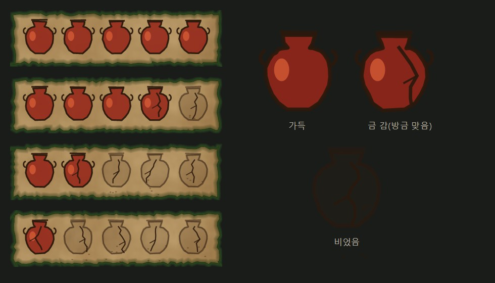 | 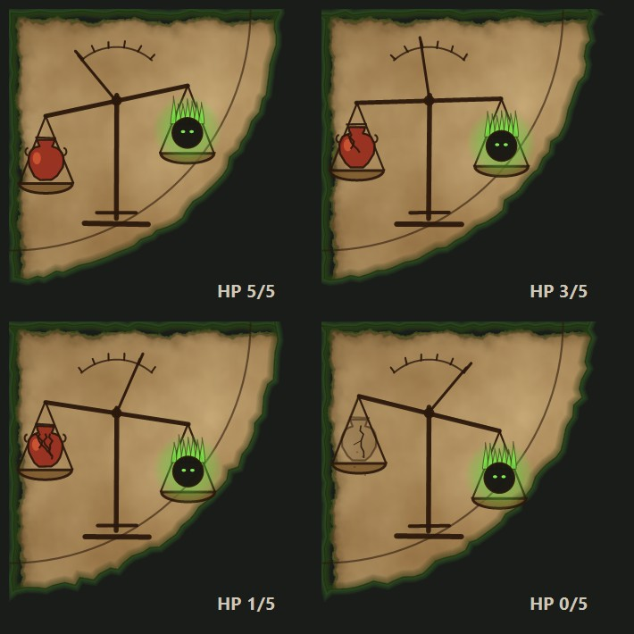 | 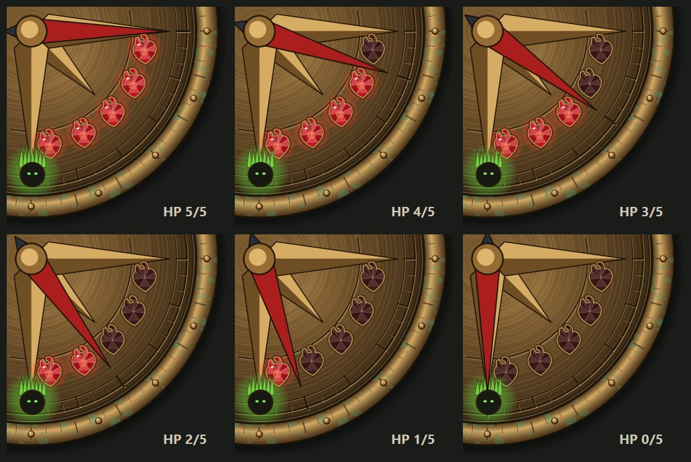 |

## 시안 4 다듬기

피드백을 하나씩 받아 고쳤습니다.

- **재질:** 금빛이 강해 동떨어져 보여서 **녹이 밴 동**(문자판·리벳)과 **니켈**(테두리·방위 꼭지·축·보석 받침) 조합으로 바꿨습니다. 문자판에는 시계 문자판식 물결 조각(기요셰)을, 테두리에는 톱니 조각(널링)을 넣었습니다. 모두 높이 지도와 셰이더로 표현해 폴리곤을 쓰지 않습니다.
- **방위 꼭지:** 문자판과 같은 금색이라 입체감이 없어서 니켈과 검은 법랑 두 면으로 나누고 능선을 높였습니다.
- **번쩍임:** 금속 광택, 보석 반짝임, 가장자리 빛이 겹쳐 번쩍거려서 금속을 무광에 가깝게 하고 빛을 줄였습니다.
- **HP 표시:** 루비 5개. 바늘이 지나가면 루비가 꺼집니다. 바늘 멈춤 자리는 HP 5 = 3시, 4 = 18°, 3 = 34°, 2 = 50°, 1 = 66°, 0 = 6시입니다. 루비 사이 간격은 16°로 고르게 맞췄습니다.
- **보석:** 처음엔 심장(장기) 모양 루비였는데 둥근 브릴리언트 컷 루비로 바꿨습니다. 받침도 단순한 고리와 공 모양 발톱이 싸 보여서, 문자판에 파묻힌 계단형 니켈 칼라와 작은 구슬 장식(밀그레인)으로 다시 만들었습니다.
- **6시 문양:** 초록 불에 감긴 해골까지 갔다가 최종적으로 빼고 비워 두었습니다.
- **가볍게:** 해골을 넣었던 단계에서 모델이 약 101만 삼각형이었는데, 해골만 97만이었습니다. 3,200으로 줄여 전체 약 2.5만 삼각형이 됐습니다. 게임에는 렌더 이미지로 들어가므로 실제 부담은 이미지 6장뿐입니다.

| HP 5 → 0 | 원본 크기(HP 3) |
| --- | --- |
| 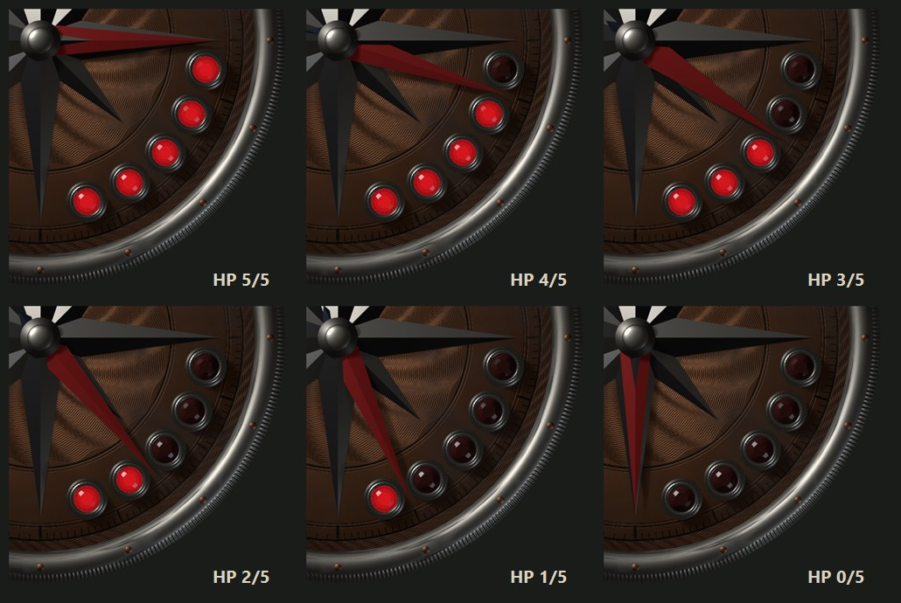 | 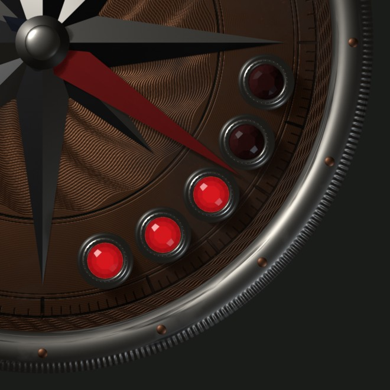 |

## 게임 적용

- HP 0~5 상태 이미지 6장(660px, 투명)을 `Assets/Art/Resources/UI/PlayerHP/`에 넣었습니다.
- 새 스크립트 `UI/PlayerHPCompassUI.cs`: 씬에 배치하지 않아도 플레이어가 있는 씬이 열리면 스스로 좌측 상단 UI를 만듭니다(1920×1080 기준 330px, 화면 크기에 맞춰 늘고 줄어듦). HP가 바뀌면 새 상태 이미지가 0.25초 동안 겹쳐 나타나고, 맞았을 때는 0.3초 살짝 흔들립니다. 씬을 고치지 않아 씬 저장이 필요 없습니다.
- `PlayerHealth`의 HP 디버그 글자는 기본으로 끄고, 켤 수 있는 옵션만 남겼습니다.
- 다른 디버그 글자(패턴 상태·조작 안내·호루스/아누비스 타이머·장착 상태)가 나침반과 겹쳐서, 공용 기준 `UI/DebugHudLayout.cs`를 두고 모두 나침반 아래로 내렸습니다. 나침반 크기가 화면에 따라 바뀌므로 내리는 거리도 화면 높이로 계산합니다.
- 플레이 중 테스트로 피해를 줘 가며 확인했습니다. 컴파일 오류는 없습니다.

| 플레이 화면 HP 2 | 플레이 화면 HP 0 |
| --- | --- |
| 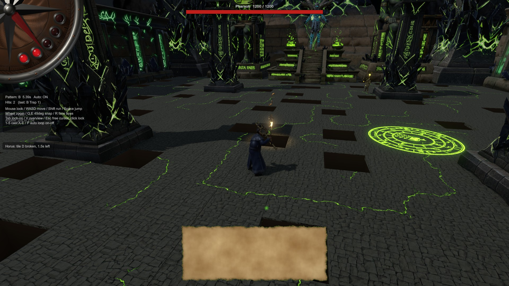 | 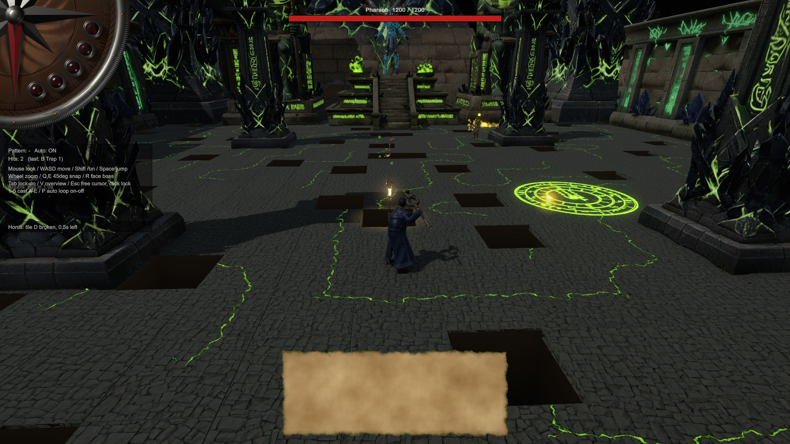 |

## 획득 아이템 UI: 펼친 고대 도감

화면 아래 가운데의 양피지 한 장에 그리던 획득 아이템 UI를, 화면 좌측 하단의 **펼친 고대 도감**으로 바꿨습니다. 왼쪽 페이지에는 주운 스태프, 오른쪽 페이지에는 주운 속성 오브가 그려집니다.

- **책:** Blender에서 실제 재질로 렌더했습니다. 얄상한 세로형 판형, 낱장이 층층이 해진 페이지 묶음, 부드러운 낡은 가죽 표지(양옆으로 살짝 드러남), 니켈 머리띠. 조명과 어두운 톤은 HP 나침반과 맞췄습니다.
- **도감 지면:** 위 표제 띠(이름 자리), 가운데 그림 칸(모서리·측정 눈금), 그림을 가리키는 번호 지시선, 아래 짧은 주석(알아볼 수 없는 옛 필체라 특정 문화에 묶이지 않음), 축척 막대.
- **아이템 삽화:** 기존 스케치 아이콘을 그대로 붙이지 않고, 윤곽과 경계를 세피아 펜선으로, 어두운 곳은 해칭(빗금)으로, 원래 색은 채도를 뺀 옅은 담채로 바꿔 도감에 펜으로 그린 것처럼 만들었습니다.
- **광채:** 그림 바깥으로만 은은하게 번집니다. 스태프는 금색, 오브는 속성색(불 주황 · 물 푸른빛 · 풀 초록 · 번개 노랑).
- **이름:** 표제 띠 안쪽을 밝게 바래게 깔고, 글자에 종이색 테를 둘러 어두운 지면에서도 읽히게 했습니다.

| 속성별 광채 |
| --- |
| 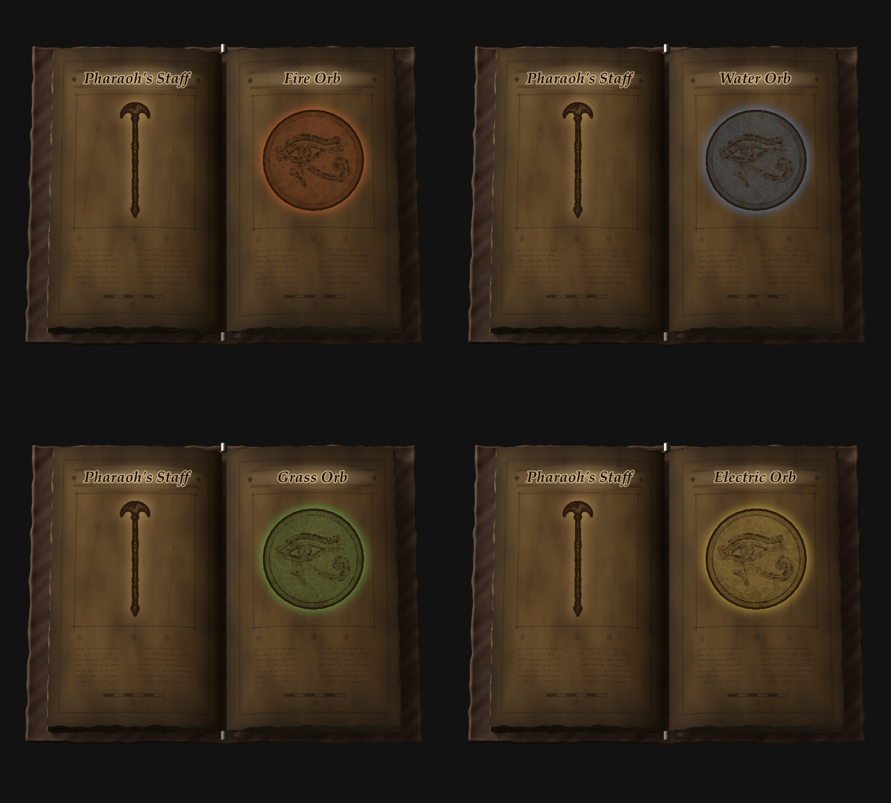 |

### 게임 적용

- 빈 도감, 스태프 5종·오브 4종 삽화, 이름 표제 9장을 이미지로 미리 구워 `Assets/Art/Resources/UI/Codex/`에 넣었습니다. 이름 글씨는 Unity에 없는 글꼴이라 이미지로 구웠습니다.
- 새 스크립트 `UI/ItemCodexUI.cs`: 플레이어가 있는 씬에서 스스로 좌측 하단 도감을 만듭니다. 들고 있는 스태프(A~E)와 오브 속성을 보고, 바뀌면 이전 그림이 번지며 지워진 뒤 새 삽화가 왼쪽에서 오른쪽으로 펜으로 그려지듯 드러나고 이름이 스며듭니다.
- 기존 양피지 UI는 실행 중에만 숨기므로 씬과 기존 스크립트는 그대로입니다.

| 스태프 E + 번개 오브 | 스태프 A + 불 오브 |
| --- | --- |
| 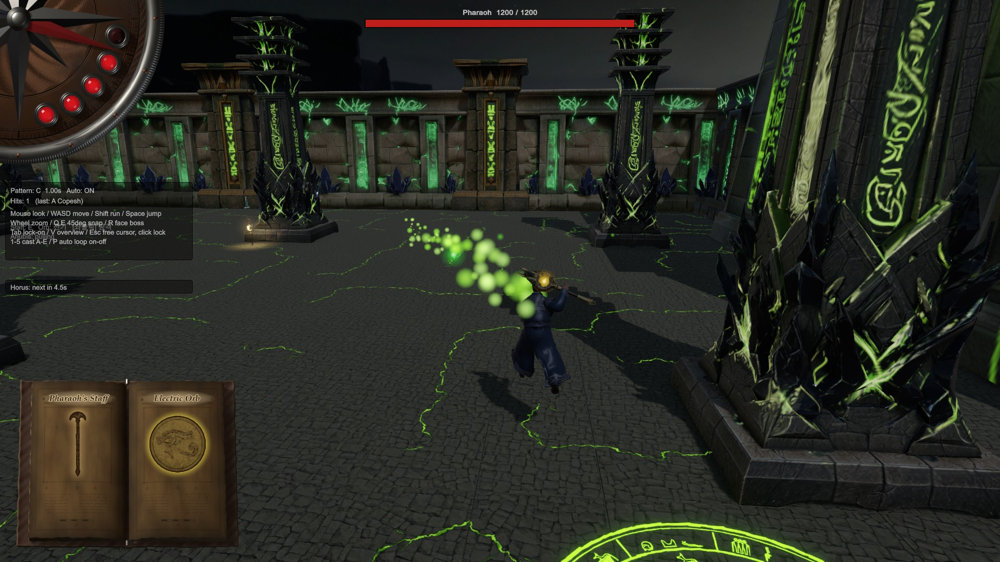 | 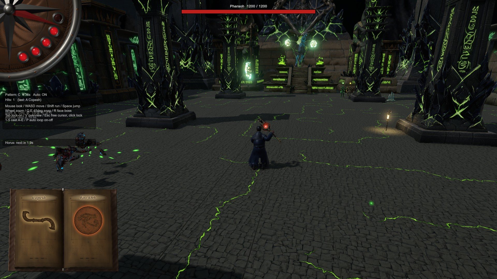 |

### 크기 조정

도감 그림 칸 아래의 주석·축척 여백을 빼서 페이지 높이를 줄이고, 화면 폭도 470px에서 400px로 줄였습니다(1920 기준). 이미지를 다시 굽고 스크립트 수치를 맞췄습니다. HP 나침반 크기는 그대로입니다.

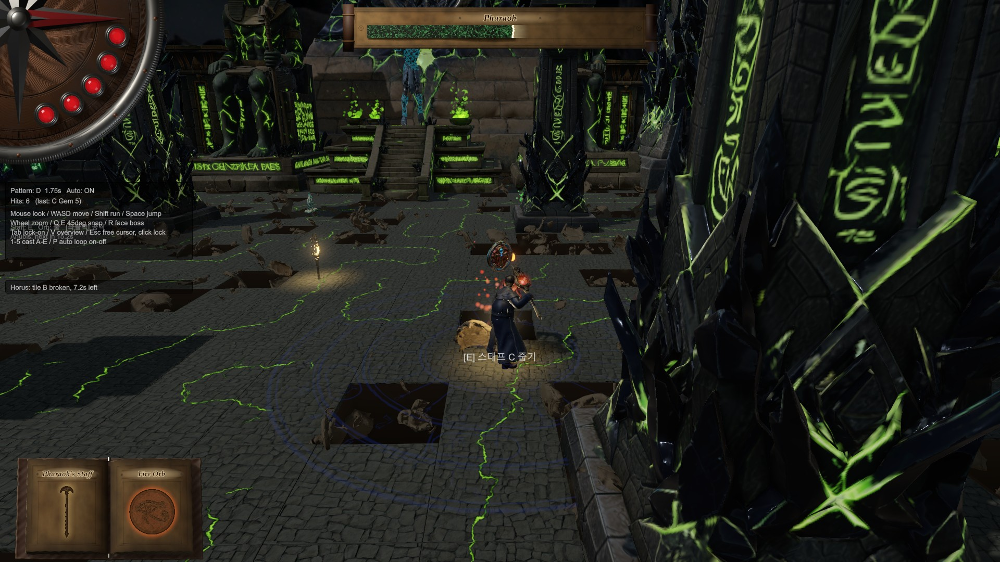

## 보스 체력바: 오염이 정화되는 도감 두루마리

체력을 깎는 빨간 막대 대신, 도감과 같은 양피지 두루마리 위의 **오염(검은 얼룩 + 초록 감염 핏줄)이 정화되며 물러나는** 형태로 만들었습니다. 처음엔 HP 나침반과 같은 니켈·동 틀로 시작했다가, "정화"라는 개념과 도감 쪽 톤에 맞추기로 하면서 양피지 두루마리로 바꿨습니다.

- Blender에서 같은 두루마리를 완전 오염·완전 정화 두 장으로 렌더하고, 중간 상태 렌더에서 금빛으로 타들어 가는 경계만 떼어 냈습니다.
- 새 스크립트 `UI/BossPurifyBarUI.cs`: 보스가 있는 씬에서 스스로 화면 위 가운데에 만듭니다(1920 기준 640px). 정화된 띠 위에 오염된 띠를 남은 체력만큼만 보이게 하고, 그 끝에 금빛 경계를 붙였습니다. 맞으면 경계가 밝아지고, 표시는 실제 체력을 부드럽게 따라갑니다.
- 보스 체력 스크립트의 디버그 막대는 기본으로 끄고 옵션만 남겼습니다.

| 체력 100% · 55% · 15% |
| --- |
| 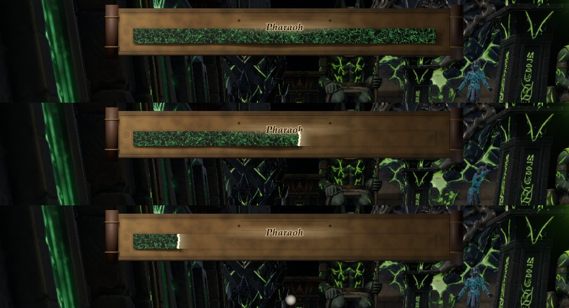 |

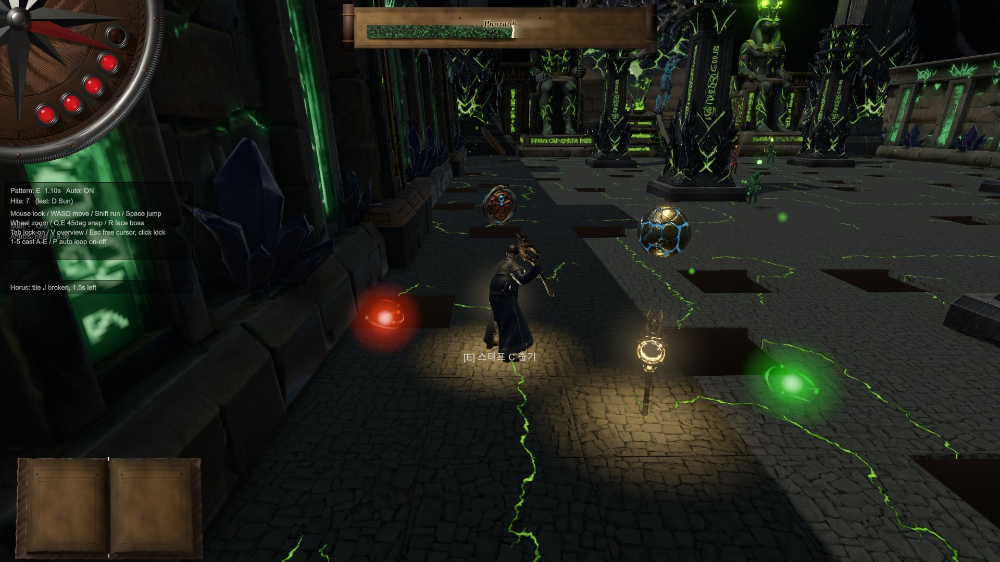

## 팀 저장소 반영: Pull Request

오전에 내 작업(스크립트 17개)을 실수로 dev 브랜치에 바로 커밋했다가 되돌린 상태였습니다. 팀 방식대로 PR로 올리도록 정리했습니다.

- 작업 커밋을 Packege 브랜치로 그대로 옮겼습니다(cherry-pick). 원본과 내용이 같은지, 팀원의 새 커밋과 겹치는 파일이 없는지 확인했습니다. Unity가 열려 있는 작업 폴더의 브랜치는 바꾸지 않고 임시 작업 폴더(worktree)에서 처리했습니다.
- Packege를 올린 뒤 PR #2(Packege → dev)로 병합되었습니다. HP 나침반·도감·보스 체력바, 스포트라이트, 에너지 코어 오브, 마법진 스크립트가 모두 dev에 들어갔습니다.
- 내 PC의 dev에 남은 원래 커밋과 되돌리기 커밋은 필요 없어져서, dev를 GitHub의 dev와 같게 맞췄습니다. 이미지·씬처럼 git에 올리지 않는 파일은 그대로이고, Unity 컴파일 오류는 없었습니다.
- 배운 점: 이전에 다른 브랜치에서 만든 커밋이 dev에 섞여 보인 것은 그 커밋이 GitHub의 dev로 올라간 적이 있어서였습니다. 앞으로는 작업 브랜치 → PR → 병합 순서를 지킵니다.

## ESC 설정창: 낡은 도감이 펼쳐지는 일시 정지 메뉴

ESC를 누르면 게임이 멈추고, 덮인 도감이 아래에서 올라와 펼쳐지는 설정창을 만들었습니다. 모든 스테이지에서 쓰기 때문에 이집트 문양은 넣지 않았습니다.

### 디자인 과정

- 처음에는 그림으로만 초안을 그려 흐름(멈춤 → 덮인 책이 올라옴 → 표지가 넘어감 → 글자가 나타남)을 정했습니다.
- 표지 가운데 호루스의 눈과 초록 핏줄은 빼고, HP 나침반과 이어지는 8방위 나침반 장미 금박으로 바꿨습니다.
- Blender에서 덮인 도감을 만들고, 가죽은 오래되고 해진 느낌(바랜 얼룩, 닳은 모서리, 갈라짐, 긁힘), 금박은 군데군데 벗겨진 놋쇠색으로 했습니다.

| 덮인 도감 | 가운데 골 |
| --- | --- |
| 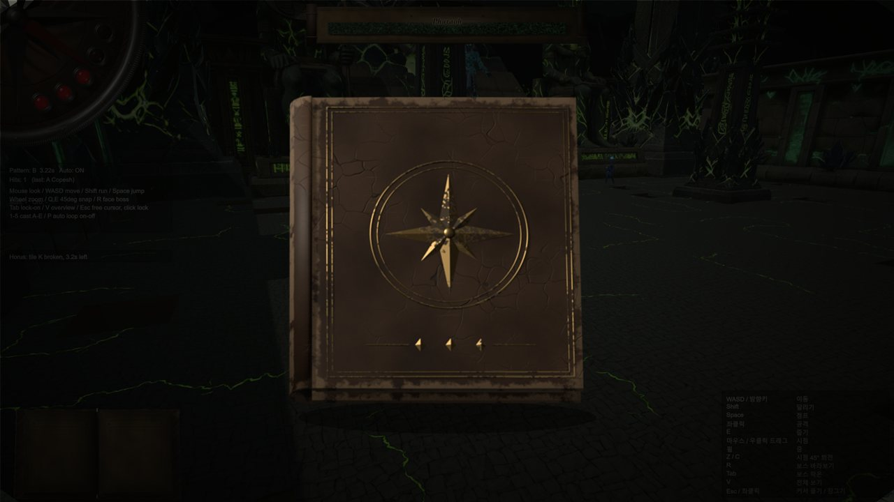 | 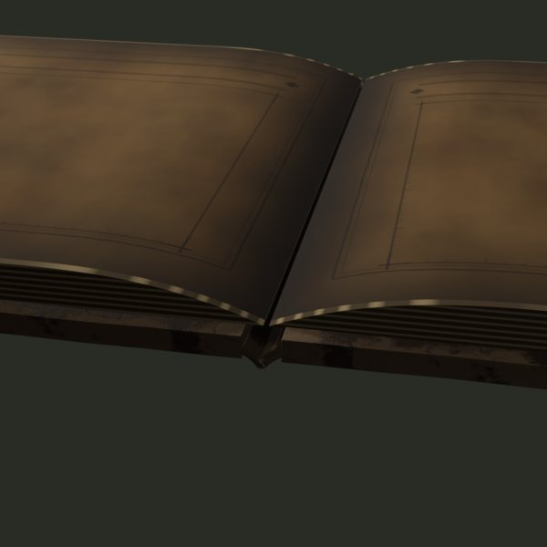 |

- 처음에는 표지만 움직이고 책등이 딱딱하게 남아 있었습니다. 책등을 앞뒤 표지 끝을 잇는 곡선으로 바꿔 펼칠 때 같이 휘게 했습니다.
- 표지와 함께 책장 절반이 넘어가고, 이어서 낱장 8장이 차례로 휘며 넘어가게 해 "촤라락" 느낌을 냈습니다.
- 펼친 책 가운데가 평평하고, 양쪽 책장이 따로 떨어져 보였습니다. 책장과 페이지가 가운데 한 줄로 휘어 들어가고, 그곳에 그늘이 지게 고쳤습니다.

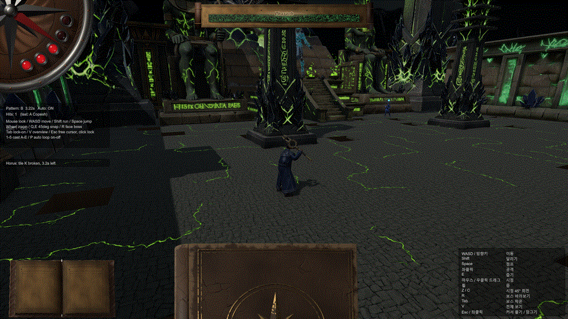

### 글자와 글꼴

- 한국어 시안에서 글자가 잘 안 보이거나 너무 쨍하다는 의견을 거쳐, 빛 번짐 없이 종이에 스민 잉크 느낌의 영문 굵은 기울임체로 정했습니다.
- 시안에 쓴 Palatino는 상용 글꼴이라 게임에 넣을 수 없었습니다. 무료 대체 글꼴을 라이선스까지 조사했습니다.
  - Palatino를 본뜬 Domitian은 원본 글꼴의 라이선스 문제로 제외했습니다.
  - 원저작자가 직접 공개한 OFL 글꼴 중 이름 예약이 없는 EB Garamond와 Cormorant Garamond를 비교했고, **EB Garamond**로 정했습니다.

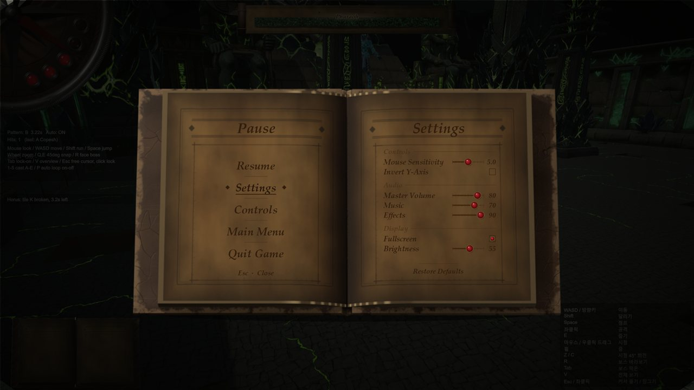

### 게임 적용 (1차)

- 새 스크립트 하나로 씬 수정 없이 자동으로 만들어집니다.
- ESC로 열면 게임이 멈추고 커서가 풀립니다. 메뉴는 Resume, Settings, Controls, Quit Game이고, Main Menu는 타이틀 화면이 생기면 연결합니다.
- 설정: 마우스 감도, Y축 반전, 음량 3종, 전체 화면, 밝기, 언어(한국어/English). 값은 저장되어 다음 실행에도 유지됩니다.
- 설정창이 열려 있는 동안 카메라·이동·공격 입력을 막았습니다. 화면 위에 그려지던 디버그 글자와 줍기 안내도 숨깁니다.
- 언어를 바꾸면 아이템 줍기 안내와 조작법 페이지가 그 언어로 바뀝니다. 한글은 실행하는 컴퓨터의 한글 글꼴을 불러 씁니다.
- 오른쪽 아래에 잠깐 넣었던 조작키 안내는 빼고, 설정창의 Controls 페이지로 옮겼습니다.

| 설정(English 선택) | 조작법(한국어 선택) |
| --- | --- |
| 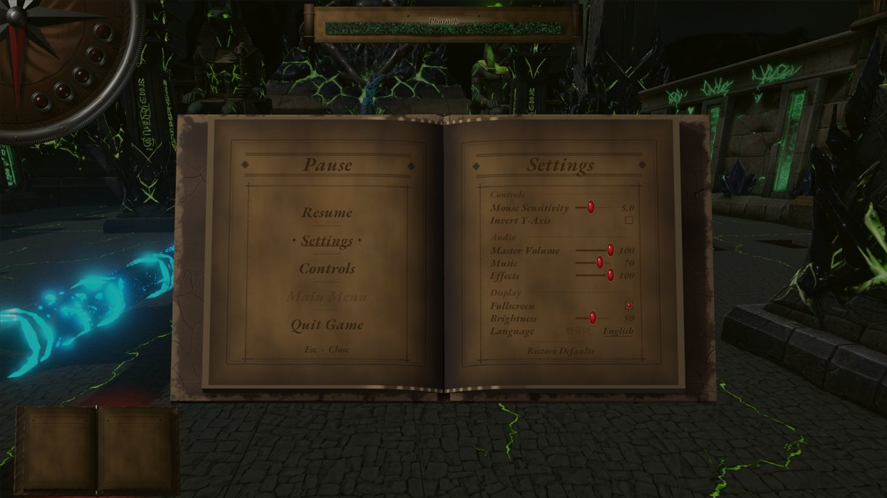 | 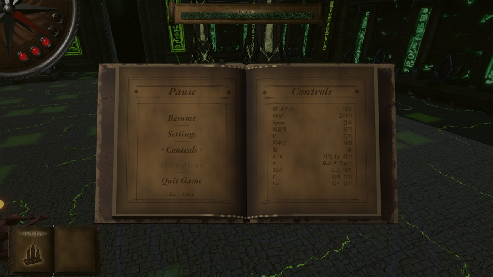 |

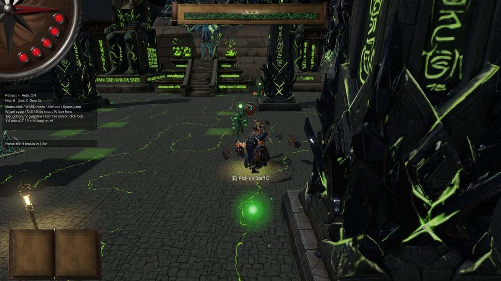

### 보스 체력바 이름 위치

보스 이름이 체력 칸 윗선에 걸쳐 있어서, 위쪽 두 줄 사이 표제 칸으로 옮겼습니다.

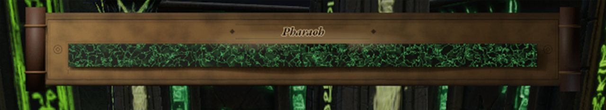

## 메모

- 보스를 쓰러뜨린 뒤 체력바가 사라지는 연출은 아직 확인하지 못했습니다.
- PR 병합 뒤 Unity 컴파일만 확인했고, 플레이 확인은 아직입니다.
- 디버그 글자 위치를 고치던 중 스크립트 일괄 치환 실수로 두 파일의 글자가 깨졌는데, 직전 백업으로 되살린 뒤 바뀐 줄만 다시 고쳤습니다. 백업과 비교해 의도한 줄만 바뀐 것을 확인했습니다.
- 설정창이 펼쳐지는 연출은 아직 게임에 넣지 않았습니다(지금은 짧게 나타나는 페이드). 설정창 글자 자체를 한국어로 바꾸려면 한글 세리프 글꼴이 더 필요합니다.
